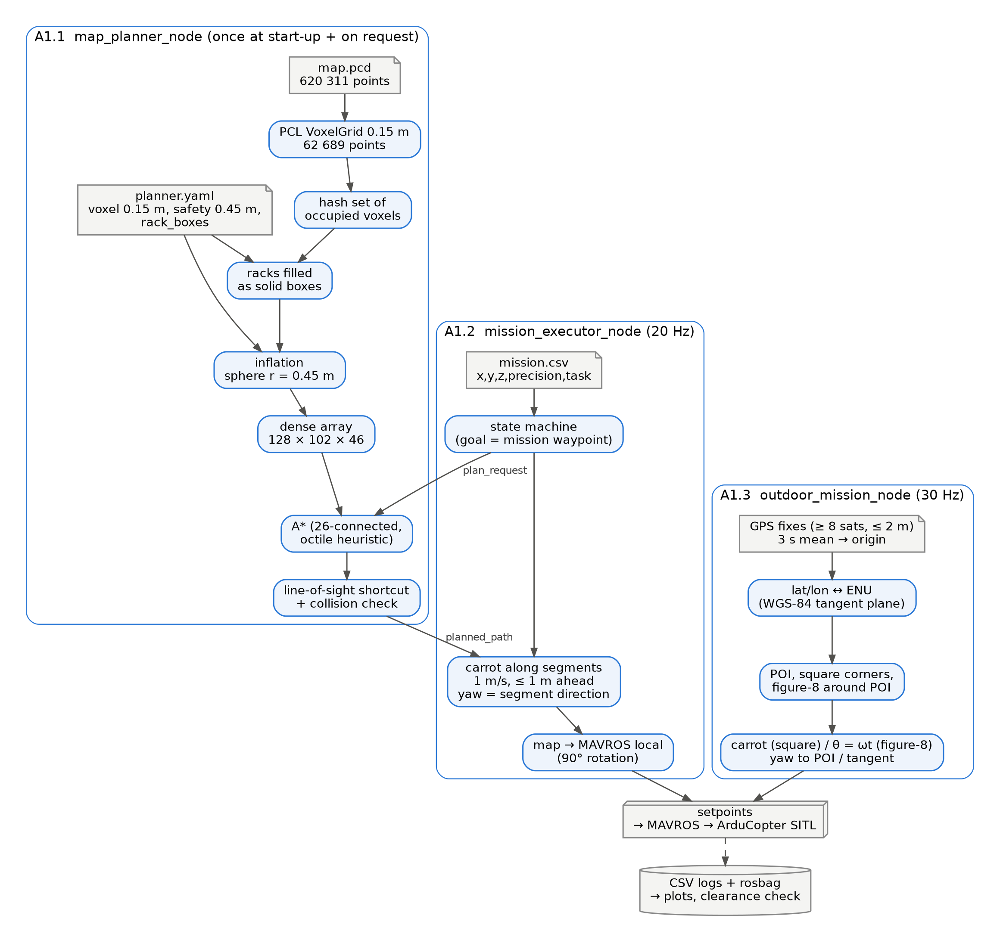
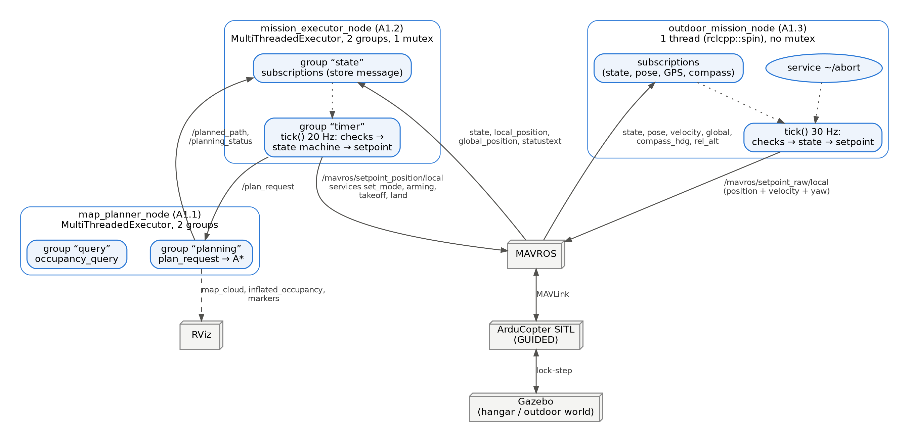
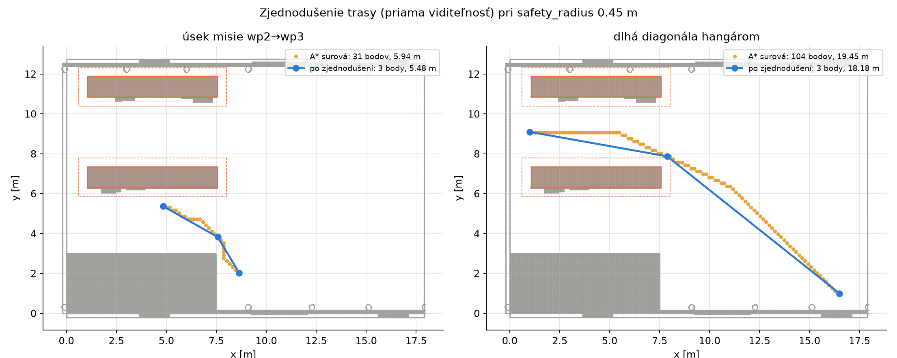
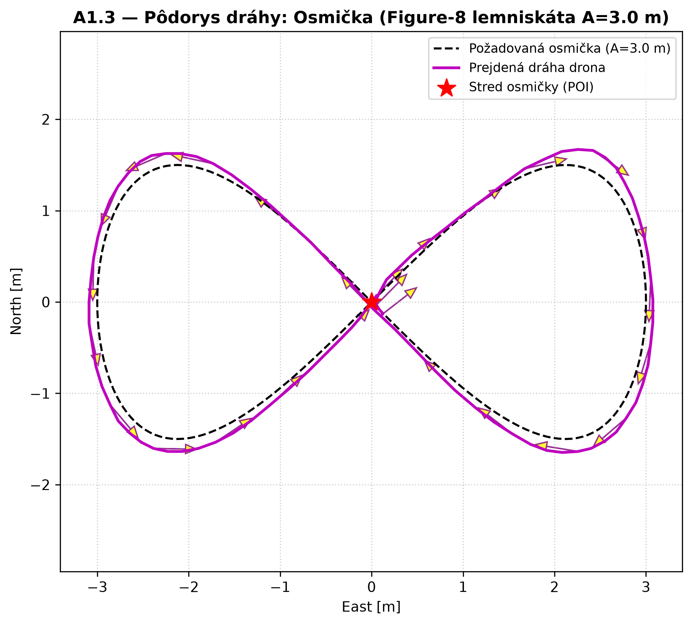

# Assignment 1 — Autonomous drone mission (A1.1 – A1.3)

**Team:** Pšenák, Valko · **Repository:** `LRS_Psenak_Valko`, branches `A-star` (A1.1), `A1_2` (A1.1 + A1.2),
`A1_3` (A1.1 + A1.3) · ROS 2 Jazzy, ArduCopter SITL, Gazebo, MAVROS

One ROS 2 package, `lrs_psenak_valko`. Indoors it loads the 3D map of the hangar, plans a collision-free
route with A* and flies a mission from a file (A1.1, A1.2). Outdoors it flies, from GPS and compass, a square
with the nose on a point of interest and a figure-8 (A1.3). This document covers all parts; the more detailed
per-part documents are in `docs/A1_1`, `docs/A1_2` (branch `A1_2`) and `docs/A1_3` (branch `A1_3`).

## How to run and what is submitted

| Part | Branch | Command | Flight record |
|---|---|---|---|
| A1.1 planner + RViz | `A-star` / `A1_2` | `./run_a1_1.sh [--start X Y Z --goal X Y Z] [--safety-radius R]` | numbers in `docs/A1_1/data/` |
| A1.2 indoor mission | `A1_2` | `./run_a1_2.sh [mission.csv]` | `results/A1_2/safety_0.45_20261018/` (rosbag, CSV, plots) |
| A1.3 outdoor mission | `A1_3` | `./run_a1_3.sh --record` | `results/A1_3/run_20261017_212049/` |

The scripts build the package (`colcon build`) and start Gazebo, SITL and MAVROS in separate terminals.
Missions: `src/lrs_psenak_valko/missions/*.csv`. Plots and 3D view of a recorded A1.2 flight: `./show_a1_2.sh`.

## Overall solution diagram

**Data flow:** the map is processed once when the planner starts. The mission holds only goal points; A*
computes the route between them and the executor follows it with a "carrot". The outdoor mission takes its
origin from GPS once and then flies on the local position.

**ROS diagram:** the three nodes, their topics and services, and how they are threaded. The planner and the
indoor executor use a `MultiThreadedExecutor` with two callback groups (the `mt_executor_demo` pattern): long
planning never blocks queries, and a burst of telemetry never delays the control timer. The outdoor node runs
in one thread on purpose.

---

## A1.1 — Map and path planning

### Map: 0.15 m voxel grid

**What:** `map.pcd` (620 311 points) is loaded with PCL, downsampled with `VoxelGrid` to 0.15 m (62 689 points)
and the occupied voxels are stored in a sparse hash set (key = three 21-bit indices in one `int64`). For A*
the occupancy is copied into a dense 128 × 102 × 46 array. Map bounds: x [−0.30, 17.95], y [−1.15, 13.20],
z [0, 5.95] m. Any point can be queried through `/occupancy_query`.

**Why:** planning over raw points would not finish in reasonable time. 0.15 m is a compromise: finer = more
voxels for A*, coarser = narrow passages close. The grid is fully 3D (not stacked 2D layers).

**Pros / cons:** + O(1) query, the sparse set saves memory. − A voxel rounds positions: an obstacle can be up
to ~0.075 m closer than the voxel centre suggests.

### Racks as solid boxes

**What:** both racks are filled as solid boxes (`rack_boxes` in `planner.yaml`: centre, size, yaw),
6.50 × 1.05 × 3.76 m centred at (4.32, 6.82) and (4.32, 11.36), from the collision shapes in the Gazebo
world. The node refuses to start without them.

**Why:** the cloud only sees shelf surfaces; between the levels the voxels look free. In the current world
file the racks are 3.76 m high (not the 5.59 m quoted in the assignment), so flying **over** a rack
(z ≥ ~4.1 m) is valid.

### Obstacle inflation: safety_radius 0.45 m

**What:** every occupied voxel grows into a sphere of radius `safety_radius` in 3D (also above and below);
the drone is then a point.

**Why 0.45 m:** drone radius to the propeller tips 0.33 m (body 0.35 × 0.35 m, propellers at ±0.15 m) +
~0.12 m for position tracking error. **Verified in flight on the same mission:** with 0.30 m the drone came
within 0.20 m of the rack edge on the descent from the rack (the propellers would hit it); with 0.45 m the
smallest clearance was 0.37 m.

**Pros / cons:** + simple and safe also above and below obstacles. − A larger radius closes passages and
blocks mission points closer than ~0.45 m to a wall (handled by "snapping" up to 0.75 m).

### A* with the octile heuristic

**What:** A* on the dense array, 26 neighbours, step cost = step length (1, √2, √3 voxels). Heuristic: axis
distances sorted d1 ≤ d2 ≤ d3, `h = voxel · [(√3 − √2)·d1 + (√2 − 1)·d2 + d3]`. A diagonal step is allowed only
if the whole cube it crosses is free (no corner cutting).

**Why:** h is the exact shortest-path length in empty space and obstacles can only make the path longer, so it
is **admissible** and also **consistent** → the route is optimal on the grid. Euclidean would also be
admissible but weaker (more expansions); Manhattan would overestimate on diagonals.

**No route:** the planner always terminates and says why: `START/GOAL_OUT_OF_BOUNDS`, `START/GOAL_OCCUPIED`,
`NO_PATH` (open list exhausted) or `TIMEOUT` (5 s). The report also gives a hint (nearest free point).

### Path simplification and collision check

**What:** line-of-sight shortcutting: from point i jump to the farthest point j reachable by a free segment
(sampled every quarter voxel). The node then checks the result again, independently, against the inflated map
and never publishes a colliding route.

**Why:** the raw route is a staircase of voxels; in A1.2 every point would mean slowing down. Shortcutting is
also exactly the step that can cut a corner, hence the second check.

### A1.1 results (no simulator, `tools/a1_1_benchmark.py`)

Map: 73 069 occupied voxels with racks, 261 759 after inflation by 0.45 m.

| Route (start → goal, m) | A* points → simplified | Length A* → final | Time |
|---|---:|---:|---:|
| around a rack (13, 7, 1.5) → (4.5, 9.1, 1.5) | 58 → 2 | 9.42 → 8.76 m | 4.4 ms |
| over a rack (12, 4, 1) → (4.3, 6.8, 4.8) | 53 → 3 | 10.30 → 9.27 m | 46.4 ms |
| mission leg (8.65, 2.02, 1) → (4.84, 5.37, 2) | 31 → 3 | 5.94 → 5.48 m | 14.7 ms |
| long diagonal (16.5, 1, 1) → (1, 9.1, 3) | 104 → 3 | 19.45 → 18.18 m | 8.3 ms |
| goal in a rack / outside the map | `GOAL_OCCUPIED` / `GOAL_OUT_OF_BOUNDS` | — | 0.0 ms |
| goal in the closed office | `NO_PATH` (331 458 voxels) | — | 618 ms |

Effect of the radius on the route over the rack: 0.30 m → 9.12 m, 0.45 m → 9.27 m, 0.75 m → 9.55 m (the route
climbs higher). Every successful route passed the independent collision check.

---

## A1.2 — Indoor mission

### Mission file and conventions

**What:** the mission path is the ROS parameter `mission_file` (`x,y,z,precision,task`; tasks `-`, `takeoff`,
`land`, `landtakeoff`, `yaw<angle>`). A bad line stops the node on the ground with the line number. Rows are
goals; A* plans the route between them (no hardcoded points).

| Frame | Where | Axes |
|---|---|---|
| `map` | mission, planner, plots, Gazebo | x = north, y = west, z up |
| MAVROS local | pose, setpoints | ENU (x = east), rotated by 90° from `map` |
| ArduPilot | inside the FCU | NED, ENU ↔ NED is done by MAVROS |

`yaw<angle>` is an **absolute** angle in the `map` frame, positive counter-clockwise, 0° = +x. The 90°
`map ↔ local` rotation was verified: Gazebo (12.99, 7.00) = MAVROS (−7.00, 12.99).

### Start-up: readiness, GUIDED, arming, takeoff

**What:** we wait for the connection, a local position and a stable GPS fix. Services (set_mode, arming,
takeoff, land) are called asynchronously with a request number, and we continue only once `/mavros/state`
confirms the real state; no reply within 5 s → ERROR. **No position setpoints are sent during takeoff.**

**Why:** in GUIDED a position setpoint cancels a running NAV_TAKEOFF, and the drone disarms itself after 10 s
on the ground. FCU messages (`PreArm: …`) are copied into our log, so the reason for a refusal is visible.

### Carrot following and heading

**What:** the setpoint (carrot) slides along the straight segment at 1 m/s and is never more than 1 m ahead of
the drone. Intermediate route points count as passed within 0.45 m, **without stopping**; only mission
waypoints have a precision. The next leg is planned while the current one is flown. The nose points along the
segment (`atan2(Δy, Δx)`); at corners sharper than 20° the drone first turns on the spot. The yaw command is
kept continuous (unwrapped): from 170° to −170° the drone turns by 20°.

**Why:** when we sent only the segment end, ArduPilot left the straight line by up to 0.56 m (descending early
over a rack). The A* route is collision-free only on the straight line.

**Pros / cons:** + the drone stays on the route and does not stop at intermediate points. − 1 m/s, short stops
at sharp corners.

### Hard and soft precision

| | Tolerance | Reached when |
|---|---|---|
| `hard` | 0.15 m | within 0.15 m **and** speed ≤ 0.2 m/s continuously for 1 s (at least 2 distinct velocity messages) |
| `soft` | 0.55 m | within 0.55 m, no stop |

**Why:** 0.15 m is in the recommended 10–20 cm range and is reached reliably in SITL (2.9–9.7 cm). The "stable
for 1 s" condition rules out a fly-by that is inside the tolerance for a single sample. Distance from obstacles
is ensured by `safety_radius`, not by the tolerance.

### Tasks yaw, land and landtakeoff

**Yaw:** target = the given absolute angle, done when the error is ≤ 5° for 0.5 s; the angle is sent in the
position setpoint (latched in GUIDED, it does not expire like a velocity command). **Land:** `cmd/land`; after
touchdown we wait for LAND to **disarm the drone by itself**; our own disarm only after 5 s and with retries
(ArduPilot refuses it until its land detector confirms touchdown). **Landtakeoff:** 3 s on the ground →
GUIDED → ARM → takeoff to the waypoint height.

### Threads and errors

**What:** `MultiThreadedExecutor`, group "state" (subscriptions only store the message) and group "timer"
(`tick()` at 20 Hz: common checks → state machine → setpoint). Shared data is protected by one mutex. ERROR
(the drone hovers at its current position) on a state timeout, a rejected service, a position older than 5 s,
a lost connection, an unexpected disarm or a mode other than GUIDED (we do not fight the pilot). With a slow
simulation the script measures Gazebo's speed and scales the timeouts.

**Pros / cons:** + control runs exactly 20 times a second. − The mutex is necessary.

### A1.2 results (SITL, safety_radius 0.45 m)

| Mission | Points | Result | Hard error | Soft error | Min clearance |
|---|---:|---|---:|---:|---:|
| `hangar_example.csv` (recorded) | 7 | DONE, disarmed | 3.9–7.3 cm | 0.30–0.40 m | 0.37 m |
| `test_east_aisle.csv` | 8 | DONE, disarmed | 2.9–7.0 cm | 0.07–0.34 m | 0.61 m |
| `test_over_racks.csv` | 7 | DONE, disarmed | 5.0–7.6 cm | 0.30–0.35 m | 0.38 m |

Clearance = distance from the drone centre to the nearest obstacle (walls, pillars, racks; not the floor),
computed from the log for every airborne pose (`plot_a1_2.py`). The comparison flight with 0.30 m
(`results/A1_2/safety_0.30_20261019/`) had only 0.20 m, which is why we use 0.45 m.

---

## A1.3 — Outdoor mission (GPS, compass, figure-8)

### Origin from GPS and GPS ↔ metres

**What:** before takeoff we wait for a fix with at least 8 satellites and accuracy within 2 m, continuously for
3 s, and average all fixes in that time = the origin (launch point). Everything is in metres from it; there is
no fixed GPS coordinate in the code. The conversion is a local tangent plane with WGS-84 radii at the origin
(east = Δλ·(N + h0)·cos φ0, north = Δφ·(M + h0)), in both directions.

**Why:** the mean is more accurate than a single random fix. The mission spans less than 8 m; against the exact
conversion through ECEF the error is 0.25 mm at 50 m and ~0.003 mm on our mission, hundreds of thousands of
times below GPS noise. GPS is used **only for the origin**; the flight itself follows the smooth local position
from ArduPilot.

**Pros / cons:** + works anywhere, no extra library. − A GPS jump during averaging shifts the whole mission;
over kilometres the error would grow (500 m → 2.5 cm).

### Angles and altitude

| What | Convention |
|---|---|
| yaw in the code and in MAVROS | ENU: 0° = east, positive counter-clockwise |
| compass (`compass_hdg`) | 0° = north, positive clockwise |
| ArduPilot | NED, converted by MAVROS |

Conversion: **yaw = 90° − heading**, wrapped into ±180° (verified: compass 0° ↔ yaw 90°, in flight the two
differed by 0.14° on average). "5 m" = 5 m above the launch point; we control the local altitude and also check
`rel_alt` (difference ≤ 1 cm). Takeoff is confirmed when the drone is within 0.2 m of 5 m and nearly still for
2 s in a row (no fixed wait).

### Square with the nose on the POI

**What:** corners W1 = NW → NE → SE → SW around the POI, side 5 m. A carrot with a trapezoidal speed profile
(acceleration ≤ 0.5 m/s²) and its velocity as feed-forward. The nose turns 30 times a second to the bearing of
the POI, computed from where the drone will be in 0.5 s (compensates the yaw lag). The square starts only when
the nose is on the POI within 5°.

**Why:** the bearing to the POI changes all the time, fastest in the middle of a side. The smooth ramp removed
sharp tilts at the corners; without feed-forward the drone lagged ~0.8 m, now ~0.1 m.

**Pros / cons:** + nose error at most 3.3°. − The 0.5 s look-ahead is an SITL estimate and needs tuning on the
real drone.

### Figure-8 and tangent heading

**What:** no waypoints. A 30 Hz timer computes θ from time and the curve point `x = A sin θ`, `y = A sin θ cos θ`
(A = 3 m, centred on the POI, 6 × 3 m). It sends position, velocity (the curve's derivative) and the tangent yaw
`atan2(cos 2θ, cos θ)` with look-ahead and unwrapping. In the first and last 3 s the rate of θ changes smoothly.

**Choice of ω:** the top speed is `A·ω·√2` (at the crossing). A 1.5 m/s limit gives ω ≤ 0.35 rad/s; we chose
**ω = 0.30 rad/s** → max 1.27 m/s, a lap in 21 s. At 0.35 the nose would have to turn at 64 °/s at the loop
ends, above ArduPilot's 60 °/s limit (54.5 °/s at 0.30).

**Geofence:** the farthest points from the launch are the square corners (3.54 m); the limit is 4 m and 5.5 m
altitude. The node checks this before flight and refuses to take off if the mission does not fit.

**Pros / cons:** + no spins or jerks, the angle corrects itself (not a yaw rate). − At the loop ends the nose
lags up to ~24°, because the required turn rate is close to ArduPilot's limit.

### Landing, abort and safety

After the figure-8 the drone flies back over the launch point and switches to LAND. **Abort:** the `~/abort`
service, leaving our own geofence or a tracking error above 2 m → LAND (or RTL/LOITER/BRAKE by parameter).
When the pilot switches the mode, the drone disarms or MAVROS drops out, the node stops sending commands and
switches nothing. The node runs in one thread (`rclcpp::spin`), so no mutex is needed.

### A1.3 results (SITL, `results/A1_3/run_20261017_212049/`)

| | Mean | Worst |
|---|---:|---:|
| square: nose vs. bearing to POI | 2.0° | 3.3° |
| square: deviation from path | 0.09 m | 0.31 m |
| figure-8: deviation from path | 0.18 m | 0.40 m |
| figure-8: nose vs. tangent | 6.7° | 23.7° |
| altitude | 5.00 m | 4.99–5.00 m |
| farthest from launch | — | 3.71 m (limit 4 m) |

