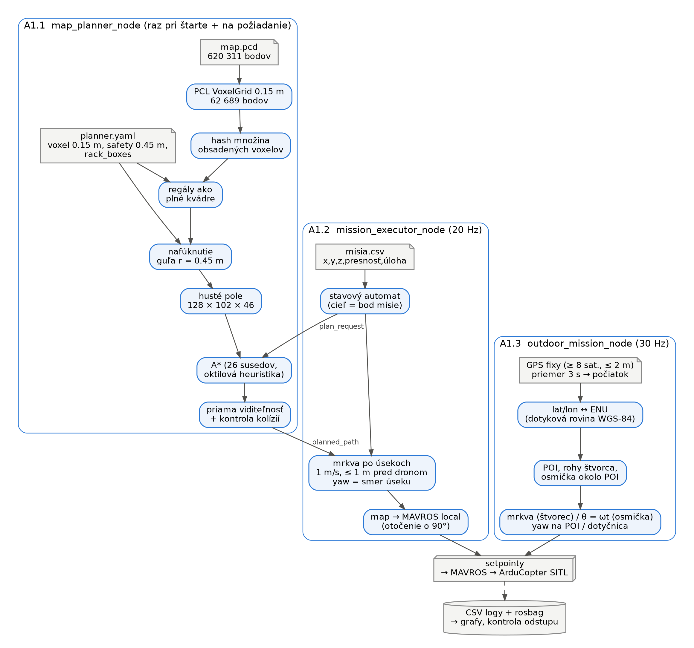
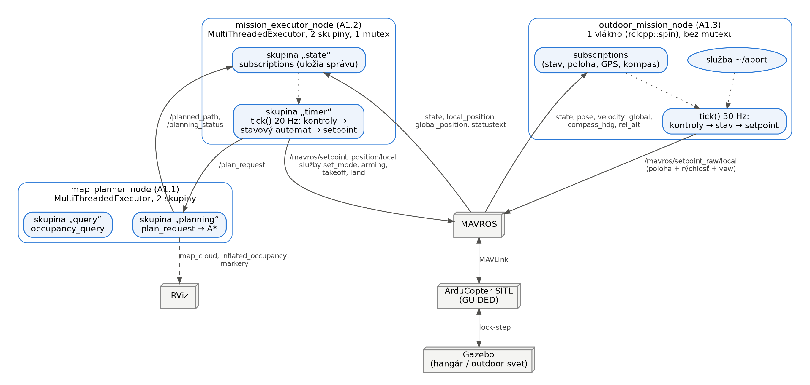

# Zadanie 1 — Autonómna misia dronu (A1.1 – A1.3)

**Tím:** Pšenák, Valko · **Repozitár:** `LRS_Psenak_Valko`, vetvy `A-star` (A1.1), `A1_2` (A1.1 + A1.2),
`A1_3` (A1.1 + A1.3) · ROS 2 Jazzy, ArduCopter SITL, Gazebo, MAVROS

Jeden ROS 2 balík `lrs_psenak_valko`. Vnútri hangára načíta 3D mapu, naplánuje bezkolíznu trasu algoritmom A*
a preletí misiu zo súboru (A1.1, A1.2). Vonku letí podľa GPS a kompasu štvorec s nosom na bod záujmu
a osmičku (A1.3). Tento dokument pokrýva všetky časti; podrobnejšie dokumenty jednotlivých častí sú
v `docs/A1_1`, `docs/A1_2` (vetva `A1_2`) a `docs/A1_3` (vetva `A1_3`).

## Spustenie a odovzdané súbory

| Časť | Vetva | Príkaz | Záznam letu |
|---|---|---|---|
| A1.1 plánovač + RViz | `A-star` / `A1_2` | `./run_a1_1.sh [--start X Y Z --goal X Y Z] [--safety-radius R]` | čísla v `docs/A1_1/data/` |
| A1.2 indoor misia | `A1_2` | `./run_a1_2.sh [misia.csv]` | `results/A1_2/safety_0.45_20261018/` (rosbag, CSV, grafy) |
| A1.3 outdoor misia | `A1_3` | `./run_a1_3.sh --record` | `results/A1_3/run_20261017_212049/` |

Skripty preložia balík (`colcon build`) a spustia Gazebo, SITL a MAVROS v samostatných termináloch.
Misie: `src/lrs_psenak_valko/missions/*.csv`. Grafy a 3D pohľad uloženého letu A1.2: `./show_a1_2.sh`.

## Celkový diagram riešenia

**Tok dát:** mapa sa spracuje raz pri štarte plánovača. Misia obsahuje len cieľové body; trasu medzi nimi
počíta A* a executor ju sleduje „mrkvou“. Outdoor misia si z GPS urobí raz počiatok a ďalej letí podľa
lokálnej polohy.

**ROS diagram:** tri uzly, ich topicy a služby, a ako bežia vlákna. Plánovač a indoor executor používajú
`MultiThreadedExecutor` s dvomi callback skupinami (vzor `mt_executor_demo`): dlhé plánovanie neblokuje
dotazy a príval telemetrie neoneskorí riadiaci časovač. Outdoor uzol beží zámerne v jednom vlákne.

---

## A1.1 — Mapa a plánovanie trasy

### Mapa: voxelová mriežka 0.15 m

**Čo:** `map.pcd` (620 311 bodov) načítame cez PCL, zmenšíme filtrom `VoxelGrid` na 0.15 m (62 689 bodov)
a obsadené voxely uložíme do riedkej hash množiny (kľúč = tri 21-bitové indexy v jednom `int64`). Pre A* sa
obsadenosť skopíruje do hustého poľa 128 × 102 × 46. Hranice mapy: x [−0.30, 17.95], y [−1.15, 13.20],
z [0, 5.95] m. Bod sa dá zvonku otestovať cez `/occupancy_query`.

**Prečo:** nad surovými bodmi by plánovanie netrvalo rozumne dlho. 0.15 m je kompromis: jemnejšie = viac
voxelov pre A*, hrubšie = zatvorí úzke priechody. Mriežka je plne 3D (nie poskladané 2D vrstvy).

**Plusy / mínusy:** + dotaz O(1), riedka množina šetrí pamäť. − Voxel zaokrúhľuje: prekážka môže byť
až ~0.075 m bližšie, než ukazuje stred voxelu.

### Regály ako plné kvádre

**Čo:** oba regály vyplníme ako plné kvádre (`rack_boxes` v `planner.yaml`: stred, rozmery, yaw),
6.50 × 1.05 × 3.76 m so stredmi (4.32, 6.82) a (4.32, 11.36), podľa kolíznych tvarov vo svete Gazeba.
Bez nich uzol nenaštartuje.

**Prečo:** mračno vidí len povrchy políc, medzi poschodiami sú „voľné“ voxely. V aktuálnom súbore sveta
majú regály výšku 3.76 m (nie 5.59 m zo zadania), preto je let **ponad** regál (z ≥ ~4.1 m) platný.

### Nafúknutie prekážok: safety_radius 0.45 m

**Čo:** každý obsadený voxel nafúkneme na guľu s polomerom `safety_radius` v 3D (aj nahor a nadol); potom
je dron bod.

**Prečo 0.45 m:** polomer drona po špičky vrtúľ 0.33 m (telo 0.35 × 0.35 m, vrtule na ±0.15 m) + ~0.12 m
na chybu sledovania polohy. **Overené letom tej istej misie:** s 0.30 m klesol dron pri zostupe z regálu na
0.20 m od jeho hrany (vrtule by zasiahli), s 0.45 m bol najmenší odstup 0.37 m.

**Plusy / mínusy:** + jednoduché a bezpečné aj nad a pod prekážkou. − Väčší polomer zatvára priechody
a blokuje body misie bližšie ako ~0.45 m od steny (rieši ich posun „snap“ do 0.75 m).

### A* s oktilovou heuristikou

**Čo:** A* nad hustým poľom, 26 susedov, cena kroku = jeho dĺžka (1, √2, √3 voxelu). Heuristika:
zoradené vzdialenosti v osiach d1 ≤ d2 ≤ d3, `h = voxel · [(√3 − √2)·d1 + (√2 − 1)·d2 + d3]`.
Diagonálny krok je povolený, len ak je voľná celá kocka, ktorú pretína (žiadne prešmyknutie cez roh).

**Prečo:** h je presná dĺžka najkratšej cesty v prázdnom priestore, prekážky ju môžu len predĺžiť, takže
je **prípustná** a aj **konzistentná** → trasa je optimálna na mriežke. Euklidovská by bola tiež prípustná,
ale slabšia (viac expanzií); Manhattanská by pri diagonálach nadhodnocovala.

**Bez cesty:** plánovač vždy skončí a povie prečo: `START/GOAL_OUT_OF_BOUNDS`, `START/GOAL_OCCUPIED`,
`NO_PATH` (open sa vyprázdnil) alebo `TIMEOUT` (5 s). Hlásenie obsahuje aj radu (najbližší voľný bod).

### Zjednodušenie trasy a kontrola kolízií

**Čo:** priama viditeľnosť: z bodu i skočíme na najvzdialenejší bod j, ku ktorému vedie voľná úsečka
(vzorkovaná každú štvrtinu voxelu). Výsledok uzol ešte raz nezávisle skontroluje proti nafúknutej mape
a kolidujúcu trasu nepublikuje.

**Prečo:** surová trasa je schodisko voxelov; každý bod by v A1.2 znamenal spomalenie. Skracovanie je zároveň
krok, ktorý môže odrezať roh, preto druhá kontrola.

### Výsledky A1.1 (bez simulátora, `tools/a1_1_benchmark.py`)

Mapa: 73 069 obsadených voxelov s regálmi, 261 759 po nafúknutí o 0.45 m.

| Trasa (štart → cieľ, m) | Body A* → po zjednodušení | Dĺžka A* → výsledná | Čas |
|---|---:|---:|---:|
| okolo regálu (13, 7, 1.5) → (4.5, 9.1, 1.5) | 58 → 2 | 9.42 → 8.76 m | 4.4 ms |
| cez regál (12, 4, 1) → (4.3, 6.8, 4.8) | 53 → 3 | 10.30 → 9.27 m | 46.4 ms |
| úsek misie (8.65, 2.02, 1) → (4.84, 5.37, 2) | 31 → 3 | 5.94 → 5.48 m | 14.7 ms |
| dlhá diagonála (16.5, 1, 1) → (1, 9.1, 3) | 104 → 3 | 19.45 → 18.18 m | 8.3 ms |
| cieľ v regáli / mimo mapy | `GOAL_OCCUPIED` / `GOAL_OUT_OF_BOUNDS` | — | 0.0 ms |
| cieľ v uzavretej kancelárii | `NO_PATH` (331 458 voxelov) | — | 618 ms |

Vplyv polomeru na trasu ponad regál: 0.30 m → 9.12 m, 0.45 m → 9.27 m, 0.75 m → 9.55 m (trasa stúpa
vyššie). Všetky úspešné trasy prešli nezávislou kontrolou kolízií.

---

## A1.2 — Misia v hangári

### Misia zo súboru a konvencie

**Čo:** cesta k misii je ROS parameter `mission_file` (`x,y,z,presnosť,úloha`; úlohy `-`, `takeoff`, `land`,
`landtakeoff`, `yaw<uhol>`). Zlý riadok zastaví uzol ešte na zemi s číslom riadku. Riadky sú ciele, trasu
medzi nimi plánuje A* (žiadne natvrdo zadané body).

| Rámec | Kde | Osi |
|---|---|---|
| `map` | misia, plánovač, grafy, Gazebo | x = sever, y = západ, z hore |
| MAVROS local | pose, setpointy | ENU (x = východ), otočené o 90° voči `map` |
| ArduPilot | vnútri FCU | NED, prevod ENU ↔ NED robí MAVROS |

`yaw<uhol>` je **absolútny** uhol v rámci `map`, kladne proti smeru hodinových ručičiek, 0° = +x. Prevod
`map ↔ local` (90°) sme overili: Gazebo (12.99, 7.00) = MAVROS (−7.00, 12.99).

### Štart: pripravenosť, GUIDED, armovanie, vzlet

**Čo:** čakáme na spojenie, lokálnu polohu a stabilný GPS fix. Služby (set_mode, arming, takeoff, land)
voláme asynchrónne s číslom požiadavky a ďalej ideme, až keď `/mavros/state` potvrdí skutočný stav; bez
odpovede do 5 s → ERROR. Počas vzletu **neposielame polohové setpointy**.

**Prečo:** polohový setpoint v GUIDED zruší rozbehnutý NAV_TAKEOFF a dron sa po 10 s na zemi sám odzbrojí.
Hlášky FCU (`PreArm: …`) kopírujeme do nášho logu, takže dôvod odmietnutia je vidieť.

### Sledovanie trasy mrkvou a smer nosa

**Čo:** setpoint (mrkva) sa posúva po priamke úseku 1 m/s a nie je viac ako 1 m pred dronom. Medziľahlé body
trasy sú prejazdné v okruhu 0.45 m **bez zastavenia**; presnosť majú len body misie. Počas letu k bodu sa už
plánuje ďalší úsek. Nos je v smere úseku (`atan2(Δy, Δx)`); pri rohu > 20° sa dron najprv otočí na mieste.
Príkaz yaw držíme spojitý (unwrap): zo 170° na −170° je to otočka o 20°.

**Prečo:** keď sme posielali rovno koniec úseku, ArduPilot opúšťal priamku až o 0.56 m (nad regálom klesal
skôr). Trasa A* je bezkolízna len na priamke.

**Plusy / mínusy:** + dron ostane na trase a nezastavuje na medziľahlých bodoch. − Rýchlosť 1 m/s, krátke
zastavenia v ostrých rohoch.

### Presnosť hard a soft

| | Tolerancia | Splnené keď |
|---|---|---|
| `hard` | 0.15 m | do 0.15 m **a** rýchlosť ≤ 0.2 m/s nepretržite 1 s (aspoň 2 rôzne správy rýchlosti) |
| `soft` | 0.55 m | do 0.55 m, bez zastavenia |

**Prečo:** 0.15 m je v odporúčanom rozsahu 10–20 cm a v SITL sa spoľahlivo dosahuje (2.9–9.7 cm). Podmienka
„1 s ustálený“ vylučuje preletenie bodu, ktoré by bolo v tolerancii len jednu vzorku. Bezpečnú vzdialenosť
od prekážok zabezpečuje `safety_radius`, nie tolerancia.

### Úlohy yaw, land a landtakeoff

**Yaw:** cieľ = zadaný absolútny uhol, splnené pri chybe ≤ 5° počas 0.5 s; uhol ide v polohovom setpointe
(v GUIDED zapamätaný, nevyprší ako rýchlostný príkaz). **Land:** `cmd/land`, po dotyku čakáme, kým LAND
dron **sám odzbrojí**; vlastný disarm až po 5 s a s opakovaním (ArduPilot ho odmietne, kým jeho detektor
nepotvrdí dotyk). **Landtakeoff:** 3 s na zemi → GUIDED → ARM → vzlet na výšku bodu.

### Vlákna a chyby

**Čo:** `MultiThreadedExecutor`, skupina „state“ (subscriptions len uložia správu) a skupina „timer“
(`tick()` 20 Hz: spoločné kontroly → stavový automat → setpoint). Zdieľané dáta chráni jeden mutex.
ERROR (dron visí na aktuálnej polohe) pri timeoute stavu, odmietnutej službe, polohe staršej ako 5 s,
strate spojenia, nečakanom odzbrojení alebo režime mimo GUIDED (nebojujeme s pilotom). Pri pomalej
simulácii skript zmeria rýchlosť Gazeba a časové limity vynásobí.

**Plusy / mínusy:** + riadenie beží presne 20× za sekundu. − Mutex je nutný.

### Výsledky A1.2 (SITL, safety_radius 0.45 m)

| Misia | Body | Výsledok | Chyba hard bodov | Chyba soft bodov | Najmenší odstup |
|---|---:|---|---:|---:|---:|
| `hangar_example.csv` (záznam) | 7 | DONE, odzbrojený | 3.9–7.3 cm | 0.30–0.40 m | 0.37 m |
| `test_east_aisle.csv` | 8 | DONE, odzbrojený | 2.9–7.0 cm | 0.07–0.34 m | 0.61 m |
| `test_over_racks.csv` | 7 | DONE, odzbrojený | 5.0–7.6 cm | 0.30–0.35 m | 0.38 m |

Odstup = vzdialenosť stredu drona k najbližšej prekážke (steny, stĺpy, regály; bez podlahy), počítaný
z logu pre každú polohu vo vzduchu (`plot_a1_2.py`). Porovnávací let s 0.30 m
(`results/A1_2/safety_0.30_20261019/`) mal odstup len 0.20 m, preto používame 0.45 m.

---

## A1.3 — Outdoor misia (GPS, kompas, osmička)

### Počiatok z GPS a prevod GPS ↔ metre

**Čo:** pred vzletom čakáme na fix s aspoň 8 satelitmi a presnosťou do 2 m, nepretržite 3 s, a zo všetkých
fixov za ten čas spravíme priemer = počiatok (miesto štartu). Všetko je v metroch od neho, v kóde nie je
žiadna pevná GPS súradnica. Prevod je lokálna dotyková rovina s polomermi WGS-84 v počiatku
(východ = Δλ·(N + h0)·cos φ0, sever = Δφ·(M + h0)), funguje oboma smermi.

**Prečo:** priemer je presnejší ako jeden náhodný fix. Misia má priemer pod 8 m; oproti presnému prevodu cez
ECEF je chyba 0.25 mm na 50 m a ~0.003 mm na našej misii, státisíckrát menej ako šum GPS. GPS sa používa
**len na počiatok**, samotný let riadi hladká lokálna poloha z ArduPilota.

**Plusy / mínusy:** + funguje na akomkoľvek mieste, bez ďalšej knižnice. − Ak GPS „uletí“ počas
priemerovania, posunie sa celá misia; na kilometroch by chyba rástla (500 m → 2.5 cm).

### Uhly a výška

| Čo | Konvencia |
|---|---|
| yaw v kóde a v MAVROS | ENU: 0° = východ, kladne proti smeru hodinových ručičiek |
| kompas (`compass_hdg`) | 0° = sever, kladne v smere hodinových ručičiek |
| ArduPilot | NED, prevod robí MAVROS |

Prevod: **yaw = 90° − kurz**, zabalené do ±180° (overené: kompas 0° ↔ yaw 90°, počas letu rozdiel v priemere
0.14°). „5 m“ = 5 m nad štartom; riadime lokálnu výšku a kontrolujeme aj `rel_alt` (rozdiel ≤ 1 cm).
Vzlet je potvrdený, keď je dron do 0.2 m od 5 m a takmer stojí 2 s v kuse (žiadne pevné čakanie).

### Štvorec s nosom na POI

**Čo:** rohy W1 = SZ → SV → JV → JZ okolo POI, strana 5 m. Mrkva s lichobežníkovým profilom rýchlosti
(zrýchlenie ≤ 0.5 m/s²) a rýchlosť ako feed-forward. Nos sa 30× za sekundu otáča na smer k POI, počítaný
z miesta, kde dron bude o 0.5 s (kompenzácia oneskorenia otáčania). Štvorec začne až keď nos mieri na POI
s chybou < 5°.

**Prečo:** smer na POI sa mení stále, najrýchlejšie v strede strany. Plynulý rozbeh odstránil prudké
náklony v rohoch; bez feed-forward dron zaostával o ~0.8 m, teraz o ~0.1 m.

**Plusy / mínusy:** + chyba nosa najviac 3.3°. − Predstih 0.5 s je odhad pre SITL, na reálnom drone treba
doladiť.

### Osmička a nos po dotyčnici

**Čo:** žiadne waypointy. Časovač 30 Hz vypočíta z času θ a bod krivky `x = A sin θ`, `y = A sin θ cos θ`
(A = 3 m, stred na POI, rozmery 6 × 3 m). Posiela polohu, rýchlosť (derivácia krivky) aj yaw dotyčnice
`atan2(cos 2θ, cos θ)` s predstihom a unwrapom. Prvé a posledné 3 s sa rýchlosť θ plynule mení.

**Voľba ω:** najväčšia rýchlosť je `A·ω·√2` (v strede). Limit 1.5 m/s → ω ≤ 0.35 rad/s; zvolili sme
**ω = 0.30 rad/s** → max 1.27 m/s, kolo 21 s. Pri 0.35 by sa nos na koncoch slučiek musel otáčať 64 °/s,
viac ako limit ArduPilota 60 °/s (pri 0.30 je to 54.5 °/s).

**Geofence:** najďalej od štartu sú rohy štvorca (3.54 m); limit 4 m a 5.5 m výšky. Uzol to prepočíta pred
letom a ak by sa misia nezmestila, nevzlietne.

**Plusy / mínusy:** + žiadne otočky ani cuknutia, uhol sa sám opravuje (nie rýchlosť otáčania). − Na koncoch
slučiek nos zaostáva až o ~24°, lebo potrebné otáčanie je blízko limitu ArduPilota.

### Pristátie, abort a bezpečnosť

Po osmičke dron preletí nad štart a prepne sa do LAND. **Abort:** služba `~/abort`, prekročenie vlastného
geofence alebo chyba sledovania > 2 m → režim LAND (alebo RTL/LOITER/BRAKE podľa parametra). Keď pilot
prepne režim, dron sa odzbrojí alebo vypadne MAVROS, uzol prestane posielať príkazy a nič neprepína.
Uzol beží v jednom vlákne (`rclcpp::spin`), takže netreba mutex.

### Výsledky A1.3 (SITL, `results/A1_3/run_20261017_212049/`)

| | Priemer | Najhoršie |
|---|---:|---:|
| štvorec: nos voči smeru na POI | 2.0° | 3.3° |
| štvorec: odchýlka od dráhy | 0.09 m | 0.31 m |
| osmička: odchýlka od dráhy | 0.18 m | 0.40 m |
| osmička: nos voči dotyčnici | 6.7° | 23.7° |
| výška | 5.00 m | 4.99–5.00 m |
| najďalej od štartu | — | 3.71 m (limit 4 m) |

