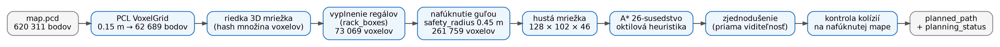
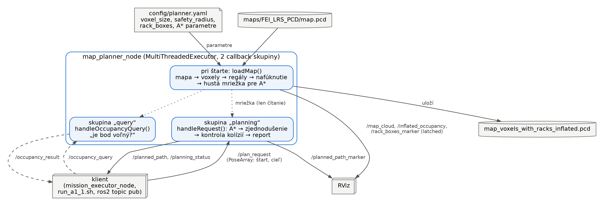
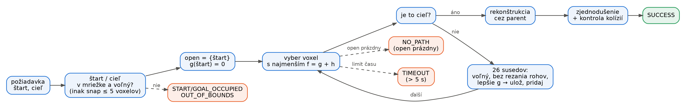
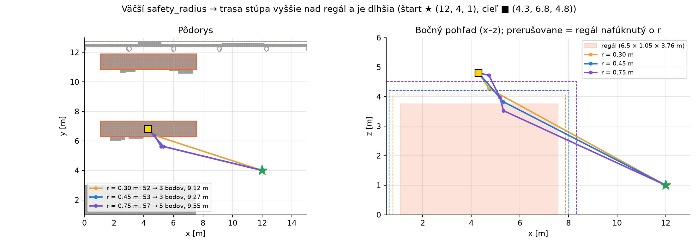
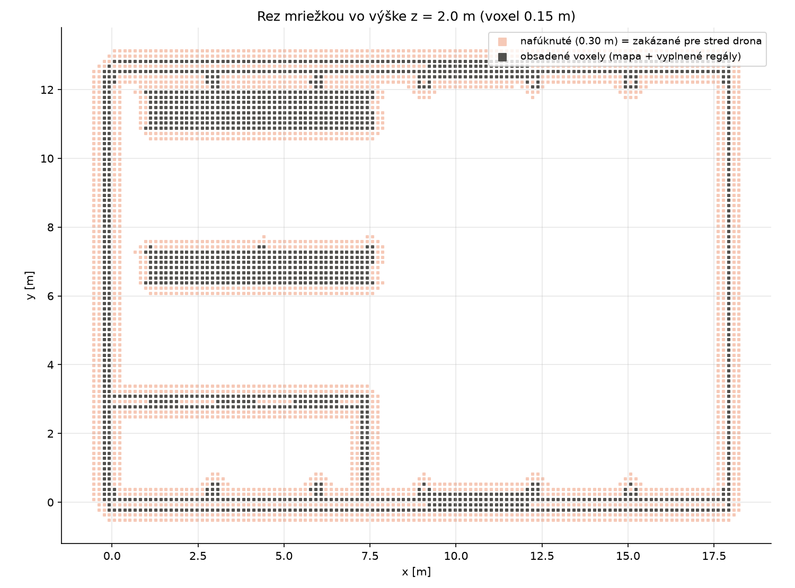
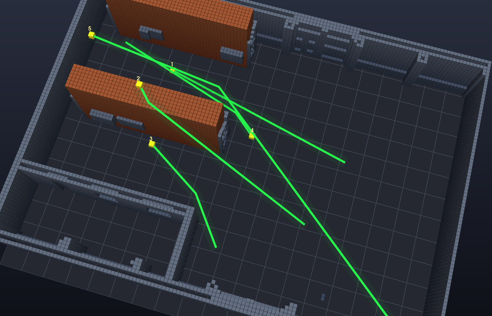

# A1.1 — Spracovanie mapy a plánovanie trasy (A*)

Uzol `map_planner_node` načíta 3D mračno bodov hangára, prevedie ho na voxelovú mriežku,
vyplní regály ako plné kvádre, nafúkne všetky prekážky o bezpečnostný polomer a na takejto
mape hľadá trasu algoritmom A* v 3D. Trasu potom zjednoduší na pár priamych úsekov
a ešte raz ju skontroluje proti nafúknutej mape. Samotný A* je v `a_star_planner.cpp`
a nezávisí od ROS, takže sa dá ľahko testovať.

**Spustenie:** `./run_a1_1.sh` (preloží balík, spustí plánovač a RViz a vyžiada ukážkovú
trasu). Iný štart a cieľ: `./run_a1_1.sh --start 12 4 2 --goal 16 8 2`, iný polomer:
`--safety-radius 0.75`. Ďalšie trasy sa dajú posielať bez reštartu na topic `/plan_request`.
**Meranie:** `python3 tools/a1_1_benchmark.py` (bez simulátora) uloží všetky čísla
z tejto dokumentácie do `docs/A1_1/data/`.

## Diagramy

**Tok dát:** mapa sa spracuje raz pri štarte, každá požiadavka potom už iba hľadá v hotovej
mriežke.



**ROS diagram:** jeden uzol, dve skupiny callbackov. Dlhé plánovanie tak nikdy neblokuje
dotaz na obsadenosť. Mriežka sa po štarte už nemení, preto ju obe vlákna len čítajú a nie je
potrebný mutex.



**Algoritmus:** A* nad hustou 3D mriežkou. Každá vetva končí stavom, ktorý plánovač aj
vypíše (prerušované šípky sú chybové prípady).



## Rozhodnutia

### Načítanie mapy

**Čo:** mapu `maps/FEI_LRS_PCD/map.pcd` (620 311 bodov) načítame knižnicou PCL
(`pcl::io::loadPCDFile`) a vypíšeme jej hranice:
x = [−0.30, 17.95] m, y = [−1.15, 13.20] m, z = [0.00, 5.95] m. Cesta k mape je ROS parameter
(relatívna k nainštalovanému balíku, alebo absolútna).

**Prečo:** PCL vie načítať PCD aj zmenšiť mračno (VoxelGrid) a výsledok vieme rovno poslať
do RViz. Vlastný parser by nič nepridal.

**Plusy / mínusy:** + overená knižnica, rýchle (celý štart plánovača trvá ~1.5 s).
− Ďalšia závislosť (`libpcl-dev`).

### Voxelová mriežka 0.15 m

**Čo:** mračno zmenšíme filtrom `VoxelGrid` na 0.15 m (62 689 bodov) a obsadené voxely
uložíme do riedkej hash množiny. Každý voxel je jedno 64-bitové číslo (tri indexy po 21
bitoch). „Voľné“ znamená „nie je v množine“. Pre A* sa obsadenosť skopíruje do hustého poľa
128 × 102 × 46 voxelov, kde je dotaz len index v poli.

**Prečo:** plánovanie nad surovými bodmi by netrvalo rozumne dlho. 0.15 m je kompromis:
jemnejšie by A* expandoval veľa voxelov, hrubšie by zavrelo úzke priechody (dron má polomer
~0.33 m). Mriežka je **plne 3D**, nie poskladané 2D vrstvy: A* sa pohybuje aj šikmo hore a dole,
napríklad ponad regál.

**Plusy / mínusy:** + dotaz „je bod voľný?“ v O(1), + riedka mriežka šetrí pamäť (hangár je
väčšinou prázdny). − Voxel zaokrúhľuje polohu: skutočná prekážka môže byť až ~0.075 m bližšie,
než ukazuje stred voxelu (pozri výsledky).

Dotaz na ľubovoľný bod funguje aj zvonku: na `/occupancy_query` (PointStamped) uzol odpovie na
`/occupancy_result` (`true` = obsadené alebo mimo mriežky). Napríklad stred regálu
(4.36, 6.82, 2.80) vráti `true`.

### Regály: plné kvádre

**Čo:** oba regály vyplníme ako plné kvádre (parameter `rack_boxes` v `planner.yaml`:
stred, rozmery, yaw). Rozmery sme zmerali z kolíznych tvarov vo svete Gazeba
(`models/fei_lrs_racks/model.sdf`): stojky 3.76 m vysoké, pôdorys 6.50 × 1.05 m, stredy
(4.32, 6.82) a (4.32, 11.36). Vyplnenie pridalo 5 419 a 5 893 voxelov.

**Prečo:** mračno vidí len povrchy políc. Medzi poschodiami regálu sú „voľné“ voxely a A*
by trasu pokojne viedol cez policu. Zadanie uvádza kolízny kváder 6.5 × 3.76 × 5.59 m, ale
v aktuálnom súbore sveta je regál zložený z políc a stojok s celkovou výškou 3.76 m. Použili
sme teda skutočné rozmery zo sveta. Preto je let **ponad** regál (z ≥ ~4.1 m) platný.

**Plusy / mínusy:** + regál je naozaj nepriechodný, + rozmery sú parametre (žiadne čísla
v kóde). − Ak sa regál vo svete posunie, treba upraviť YAML; uzol bez regálov nenaštartuje
(`require_rack_boxes: true`).

### Nafúknutie prekážok (safety_radius 0.30 m)

**Čo:** každý obsadený voxel nafúkneme na guľu s polomerom `safety_radius` (ROS parameter
v `config/planner.yaml`, teraz 0.30 m) v 3D, teda aj nahor a nadol. Potom sa dron dá brať ako
bod: každý voľný voxel je bezpečný pre jeho stred.

**Prečo 0.30 m:** obsadený voxel reprezentuje jeho stred, skutočný povrch je bližšie k dronu
najviac o pol voxelu, a trasa navyše vedie stredmi voľných voxelov. Reálny odstup preto vychádza
väčší ako samotný polomer: pri lete v A1.2 bol najmenší odstup od regálu 0.37 m, čo je viac ako
polomer drona po špičky vrtúľ 0.33 m (telo 0.35 × 0.35 m, vrtule na ±0.15 m). Menší polomer
nechá otvorené úzke priechody a body misie blízko stien. Väčší polomer viditeľne mení trasu
(obrázok nižšie); na obhajobe sa dá zmeniť cez `./run_a1_1.sh --safety-radius 0.45`.

**Plusy / mínusy:** + jednoduché a bezpečné aj nad a pod prekážkou, + nezatvára priechody.
− Rezerva nad polomerom drona je len niekoľko cm. − Príliš veľký polomer zavrie úzke
priechody a body misie blízko steny (rieši ich „snap“, pozri ďalej).

### A* a heuristika

**Čo:** A* nad hustou mriežkou, 26 susedov (aj diagonály v 2D a 3D), cena kroku = jeho dĺžka
(1, √2 alebo √3 voxelu). Heuristika je **3D oktilová vzdialenosť**: osi zoradíme
d1 ≤ d2 ≤ d3 a

```
h = voxel · [ (√3 − √2)·d1 + (√2 − 1)·d2 + d3 ]
```

**Prečo:** je to presná dĺžka najkratšej cesty v prázdnom priestore pri 26 susedoch.
Prekážky môžu cestu len predĺžiť, preto h nikdy nenadhodnotí (**prípustná**). Je aj
**konzistentná**, takže žiadny voxel sa neexpanduje dvakrát a výsledok je najkratšia trasa
na mriežke. Euklidovská vzdialenosť by bola tiež prípustná, ale menšia, takže A* by
expandoval viac voxelov. Manhattanská by pri diagonálach nadhodnocovala.

**Plusy / mínusy:** + optimálna trasa za milisekundy (4–25 ms). − Optimálna len na mriežke, nie
v spojitom priestore (to dorovná zjednodušenie).

### Žiadne „prešmyknutie“ cez roh

**Čo:** diagonálny krok je povolený, len ak sú voľné **všetky** voxely v kocke, ktorú krok
pretína (2 × 2 alebo 2 × 2 × 2).

**Prečo:** inak by trasa prešla medzi dvoma obsadenými voxelmi, ktoré sa dotýkajú len hranou
alebo rohom. Takou medzerou žiadny dron neprejde.

### Keď trasa neexistuje

**Čo:** plánovač vždy skončí a povie prečo: `START/GOAL_OUT_OF_BOUNDS`,
`START/GOAL_OCCUPIED`, `NO_PATH` (prehľadal celý dosiahnuteľný priestor) alebo `TIMEOUT`
(limit 5 s). Správa na `/planning_status` obsahuje aj dôvod a radu (najbližší voľný bod, ako
blízko sa A* dostal k cieľu).

**Prečo:** každý voxel sa uzavrie najviac raz, takže zoznam open sa raz vyprázdni. Časový
limit chráni pred veľkými mapami. Executor v A1.2 podľa tejto správy misiu bezpečne zastaví.

**Plusy / mínusy:** + nikdy nezamrzne. − `NO_PATH` v uzavretej kancelárii trvá ~0.7 s, lebo
musí prehľadať celý hangár (358 415 voxelov).

### Posun štartu a cieľa (snap)

**Čo:** ak štart alebo cieľ leží v nafúknutom priestore, použije sa najbližší voľný voxel do
5 voxelov (0.75 m). V A1.2 executor odmietne trasu, ak sa cieľ posunul viac než o toleranciu
bodu (0.15 m hard, 0.55 m soft).

**Prečo:** bod misie 0.4 m od steny je pre stred drona ešte bezpečný, ale leží v nafúknutej
zóne. Bez posunu by sa nedal naplánovať vôbec.

### Zjednodušenie trasy

**Čo:** **priama viditeľnosť** (line-of-sight shortcutting). Z bodu i skočíme na najvzdialenejší
ďalší bod j, ku ktorému vedie voľná úsečka, a pokračujeme z j. Úsečku kontrolujeme každú
štvrtinu voxelu (0.0375 m) proti nafúknutej mape.

**Prečo:** surová trasa A* je schodisko voxelov (31–104 bodov). V A1.2 by každý bod znamenal
spomalenie, takže dron by sa pohyboval skokmi. Po zjednodušení zostanú 2–5 body a trasa je
aj kratšia (napr. 19.45 → 18.18 m).

**Plusy / mínusy:** + oveľa menej bodov aj kratšia trasa. − Ostré rohy zostávajú (bez spline);
executor v A1.2 sa pred ostrým rohom otočí na mieste.

### Kontrola kolízií po zjednodušení

**Čo:** pred zverejnením uzol znova skontroluje každý bod a každú úsečku výslednej trasy proti
nafúknutej mape. Kolidujúcu trasu nikdy nezverejní a nahlási chybu.

**Prečo:** práve skracovanie môže „odrezať roh“ cez policu. Druhá, nezávislá kontrola to
zachytí.

## Výsledky (bez simulátora)

Všetky čísla zmeral `tools/a1_1_benchmark.py`, uložené sú v `docs/A1_1/data/benchmark.json`
(a surové trasy v `benchmark_raw.json`). Mapa: 73 069 obsadených voxelov (s regálmi),
234 353 po nafúknutí o 0.30 m.

| Trasa (štart → cieľ, m) | Body A* → po zjednodušení | Dĺžka A* → výsledná | Čas plánovania |
|---|---:|---:|---:|
| okolo regálu do uličky (13, 7, 1.5) → (4.5, 9.1, 1.5) | 58 → 2 | 9.42 → 8.76 m | 15.9 ms |
| cez regál (12, 4, 1) → (4.3, 6.8, 4.8) | 52 → 3 | 10.21 → 9.12 m | 24.2 ms |
| úsek misie (8.65, 2.02, 1) → (4.84, 5.37, 2) | 29 → 3 | 5.76 → 5.37 m | 8.3 ms |
| úsek misie (2.08, 9.74, 1.75) → (8.84, 6.9, 2) | 46 → 3 | 8.01 → 7.41 m | 4.5 ms |
| dlhá diagonála (16.5, 1, 1) → (1, 9.1, 3) | 104 → 3 | 19.45 → 18.19 m | 13.1 ms |
| cieľ v strede regálu | `GOAL_OCCUPIED` | — | 0.0 ms |
| cieľ mimo mapy (25, 7, 1.5) | `GOAL_OUT_OF_BOUNDS` | — | 0.0 ms |
| cieľ v uzavretej kancelárii (3, 1.5, 0.8) | `NO_PATH`, 358 415 voxelov | — | 665 ms |

Všetky úspešné trasy prešli nezávislou kontrolou kolízií. Plánovač hľadal trasy aj v A1.2 pre
tri rôzne misie (22 úsekov) a všetky boli preletené bez kolízie.

**Vplyv safety_radius** na trasu ponad regál:

| safety_radius | Body | Dĺžka | Čas |
|---:|---:|---:|---:|
| 0.30 m (použité) | 52 → 3 | 9.12 m | 24.2 ms |
| 0.45 m | 53 → 3 | 9.27 m | 46.4 ms |
| 0.75 m | 57 → 5 | 9.55 m | 63.7 ms |




**Rez mriežkou** vo výške 2 m: tmavé sú obsadené voxely (aj vyplnené regály), svetlé je
nafúknutá zóna. Je vidieť, prečo cieľ v kancelárii vľavo dole nie je dosiahnuteľný: kancelária
je zo všetkých strán uzavretá.



**3D pohľad** na testované trasy (zelená rúra = trasa, priesvitný obal = safety_radius,
oranžové = regály, steny nad 2.6 m skryté):



## Čo nefunguje dokonale

- **Diery v streche mračna.** Pozdĺž hrebeňa strechy (y ≈ 4–7 m) chýbajú v mračne body.
  Test s cieľom nad strechou (9, 6, 6.35) preto **našiel trasu von** cez dieru. V Gazebe má
  strecha kolízny model, takže takú trasu nesmieme poslať. Body misie sú vždy v hangári, no pre istotu
  by sa diery dali zakryť ďalším kvádrom v `rack_boxes` alebo stropom (max. výška).
- **Zaokrúhlenie voxelov:** skutočná prekážka môže byť až ~0.075 m bližšie, než ukazuje stred
  voxelu. Pri 0.30 m je rezerva nad polomerom drona (0.33 m) len pár cm; kto chce viac,
  zvýši `safety_radius` (napr. 0.45 m), za cenu zatvorenia úzkych priechodov.
- **Žiadne vyhladenie (spline):** trasa má ostré rohy, pred ktorými sa dron v A1.2 na chvíľu
  zastaví a otočí.
- **NO_PATH je pomalý** (~0.7 s), lebo A* musí prehľadať celý dosiahnuteľný priestor.
- **Optimálna len na mriežke 0.15 m:** zjednodušená trasa je kratšia, ale nie najkratšia
  možná v spojitom priestore.
