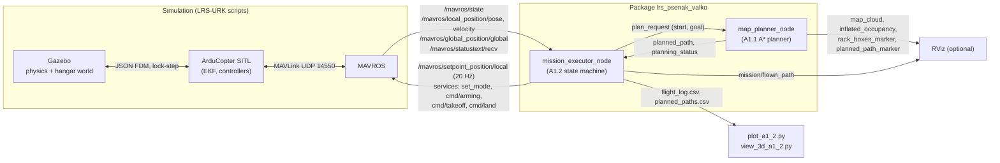
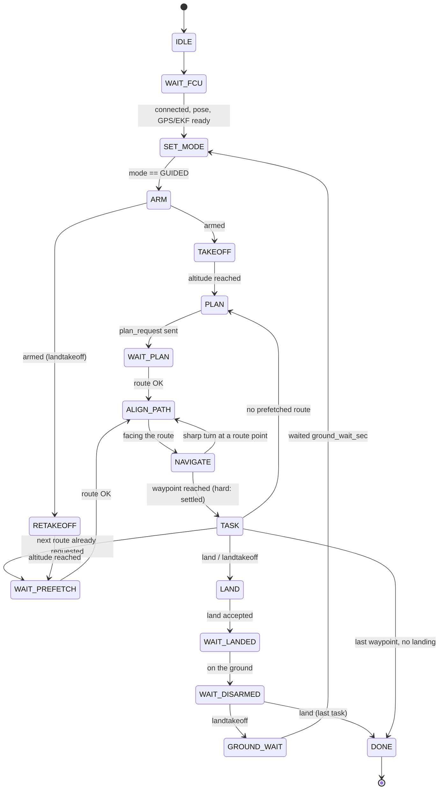

# A1.2: Indoor mission execution (FEI LRS hangar)

Team: Pšenák, Valko. Branch `A1_2` (based on `A-star`, which holds the A1.1 planner).

This document describes how the A1.2 solution works, how to run it, how its behaviour was
verified, and why each design decision was made. File and line references point into this
repository.

---

## Contents

1. [What the solution does](#1-what-the-solution-does)
2. [Quick start](#2-quick-start)
3. [Architecture](#3-architecture)
4. [Mission file format](#4-mission-file-format)
5. [Coordinate frames and yaw convention](#5-coordinate-frames-and-yaw-convention)
6. [The state machine](#6-the-state-machine)
7. [Takeoff, land and landtakeoff](#7-takeoff-land-and-landtakeoff)
8. [Navigation between waypoints](#8-navigation-between-waypoints)
9. [Hard and soft precision](#9-hard-and-soft-precision)
10. [Yaw](#10-yaw)
11. [Path planner (A1.1, used by A1.2)](#11-path-planner-a11-used-by-a12)
12. [Safety margin and collision checking](#12-safety-margin-and-collision-checking)
13. [Threads, callbacks and timing](#13-threads-callbacks-and-timing)
14. [Run script `run_a1_2.sh`](#14-run-script-run_a1_2sh)
15. [Logs, rosbag, plots and the 3D view](#15-logs-rosbag-plots-and-the-3d-view)
16. [Verification results](#16-verification-results)
17. [Parameters](#17-parameters)
18. [Troubleshooting](#18-troubleshooting)
19. [Known limitations](#19-known-limitations)
20. [File map](#20-file-map)

---

## 1. What the solution does

Given a mission file (a list of goal waypoints, each with a precision and a task), the solution
flies a simulated quadcopter (ArduCopter SITL + Gazebo, controlled through MAVROS) through the
hangar without touching the walls or the shelving racks:

* it waits until the flight controller is ready, switches to `GUIDED`, arms and takes off;
* for every waypoint it asks the A* planner (A1.1) for a collision-free route from where the
  drone is to the waypoint, and flies that route facing the direction of travel;
* at `hard` waypoints it stops and settles (within 0.15 m, below 0.2 m/s); `soft` waypoints are
  passed through (within 0.55 m) without stopping;
* it executes the waypoint's task: `yaw<angle>`, `land`, `landtakeoff` or `takeoff`;
* it ends landed and disarmed, then saves logs, a rosbag and plots.

The whole run is unattended, from `./run_a1_2.sh` to the disarm after the last landing.

## 2. Quick start

```bash
cd ~/Zadania/LRS_Psenak_Valko
./run_a1_2.sh                                              # default mission (hangar_example.csv)
./run_a1_2.sh src/lrs_psenak_valko/missions/test_over_racks.csv   # any mission file
```

The script builds the package, opens Gazebo, SITL and MAVROS in three terminal windows (or reuses
them if they are already running), starts the planner and the executor, and at the end opens the
plot windows and the 3D view. Useful options (environment variables):

| Variable | Effect |
|---|---|
| `A1_2_SKIP_BUILD=1` | do not run `colcon build` |
| `A1_2_STOP_SIM=1` | close Gazebo, SITL and MAVROS at the end |
| `A1_2_START_SIM=0` | you started Gazebo, SITL and MAVROS yourself |
| `A1_2_RECORD=0` | no rosbag |
| `A1_2_SHOW_PLOTS=0`, `A1_2_SHOW_3D=0` | save the plots but do not open windows |
| `A1_2_RVIZ=1` | also open RViz with map, racks, planned and flown path |

All options are listed at the top of [run_a1_2.sh](../../run_a1_2.sh).

Do not click inside the Gazebo window during a flight: its ⏸ button pauses the simulation, which
freezes ArduPilot (see [Troubleshooting](#18-troubleshooting)).

## 3. Architecture



| Process | Role |
|---|---|
| **Gazebo** (`run_gazebo.sh`) | simulates the physics of the drone and the hangar (walls, racks) |
| **ArduCopter SITL** (`run_sitl.sh`) | the real flight-controller firmware running on the PC: EKF state estimation, position/attitude controllers, arming checks, flight modes. It exchanges sensor data and motor commands with Gazebo in lock-step. |
| **MAVROS** (`run_mavros.sh`) | translates between ROS 2 topics/services and MAVLink messages to/from ArduPilot |
| **map_planner_node** | loads the hangar point cloud, builds the voxel occupancy grid with inflated obstacles, answers route requests with A* |
| **mission_executor_node** | reads the mission, runs the state machine, talks to MAVROS and the planner, logs the flight |

## 4. Mission file format

CSV, one goal waypoint per line, `#` starts a comment, an optional header line `x,y,z,...` is
skipped ([mission_model.cpp](../../src/lrs_psenak_valko/src/mission_model.cpp)):

```text
# x,y,z,precision,task
13.60,1.50,1.00,soft,takeoff
4.84,5.37,2.00,hard,yaw180
8.84,6.90,2.00,hard,landtakeoff
13.60,1.50,2.00,hard,land
```

| Field | Meaning |
|---|---|
| `x, y, z` | goal position in metres, **map frame** (the frame of the hangar map, see §5) |
| `precision` | `hard` (stop and settle) or `soft` (pass through) |
| `task` | `-` (none), `takeoff`, `land`, `landtakeoff`, or `yaw<deg>` such as `yaw90`, `yaw-45` |

The rows are goals, not a flight path. The route between two rows is planned by A*.
Parsing is strict: a wrong field count, a non-number, or an unknown precision or task stops the
executor at start-up with the offending line number.

## 5. Coordinate frames and yaw convention

Two frames are involved:

* **map**: the frame of the hangar point cloud (`map.pcd`), the planner, the mission file, the
  plots and Gazebo's world frame. +x points along the long side of the hangar (north), +y points
  west, z up. It is right-handed.
* **MAVROS local**: ArduPilot's local frame, which MAVROS publishes as ENU (x east, y north, z up).

They differ only by a rotation of 90° about z (`map_to_local_yaw_offset_deg = 90`). The start pose
proves it: MAVROS reports local `(-7.00, 12.99, 0.00)`, which is map `(12.99, 7.00, 0.00)`, the
drone's spawn position in the Gazebo world.

```text
map  -> local:  x_l = cos(a)·x_m − sin(a)·y_m,   y_l = sin(a)·x_m + cos(a)·y_m,   yaw_l = yaw_m + a
local -> map:   x_m = cos(a)·x_l + sin(a)·y_l,   y_m = −sin(a)·x_l + cos(a)·y_l,  yaw_m = yaw_l − a
with a = 90°
```

These are `mapToLocalPose()` and `localToMapPose()` in
[mission_executor_node.cpp](../../src/lrs_psenak_valko/src/mission_executor_node.cpp). Everything
inside the executor (targets, distances, the carrot, logs) is in the map frame. Conversion happens
only at the MAVROS boundary: incoming poses are converted to map, outgoing setpoints to local.

**ENU vs NED.** ArduPilot works in NED (north, east, down) internally. MAVROS converts NED to ENU
for every topic and back for every setpoint. The executor never touches NED, which avoids the
classic mirrored or 90°-rotated heading bug.

**Yaw convention (for `yaw<deg>` tasks):** the angle is an **absolute heading in the map frame**,
in degrees, **counter-clockwise positive**, **0° = the map +x axis**. `yaw90` faces map +y,
`yaw180` faces −x, `yaw-90` faces −y. It is not relative to the current heading.

## 6. The state machine

`tick()` runs at 20 Hz. Every transition is logged with a timestamp (`Mission state: ...`).



Any state can go to `ERROR` (timeout, rejected service, lost link, unexpected disarm, mode
change). In `ERROR` the executor keeps sending the last measured position as a hold setpoint.

| State | What happens | Leaves when | Timeout |
|---|---|---|---|
| `IDLE` | first tick | immediately | – |
| `WAIT_FCU` | waits for `/mavros/state.connected`, fresh local pose, and GPS/EKF readiness | EKF reports "is using GPS", or GPS fix stable `gps_stable_sec` | `fcu_ready_timeout_sec` 600 s |
| `SET_MODE` | requests `GUIDED` every `mode_retry_interval_sec` | `/mavros/state.mode == GUIDED` | `handshake_timeout_sec` |
| `ARM` | requests arming every `arm_retry_interval_sec`; FCU refusal reasons are logged | `/mavros/state.armed` | `handshake_timeout_sec` |
| `TAKEOFF` | sends `NAV_TAKEOFF` to the first waypoint's z; **no setpoints** | z ≥ target − 0.15 m | `takeoff_timeout_sec` |
| `PLAN` / `WAIT_PLAN` | sends `plan_request` (current pose → waypoint) and waits for `planned_path` + `planning_status` | route received and its end within tolerance of the goal | `planner_timeout_sec` |
| `ALIGN_PATH` | hovers and turns to the heading of the next route segment | heading within 5° for `yaw_hold_time_sec` | `yaw_timeout_sec` |
| `NAVIGATE` | carrot following along the route (§8) | last route point reached (hard: settled) | `navigation_timeout_sec` |
| `TASK` | executes the waypoint task | task done | `yaw_timeout_sec` |
| `WAIT_PREFETCH` | uses the route for the next waypoint that was requested in advance | route available | `planner_timeout_sec` |
| `LAND` | sends `/mavros/cmd/land` (ArduCopter switches to LAND) | accepted | `landing_timeout_sec` |
| `WAIT_LANDED` | waits for z ≤ 0.15 m and speed ≤ 0.15 m/s, or disarm | on the ground | `landing_timeout_sec` |
| `WAIT_DISARMED` | waits for LAND mode to disarm; sends disarm itself only after `disarm_grace_sec` | `armed == false` | `landing_timeout_sec` |
| `GROUND_WAIT` | stays on the ground `ground_wait_sec` (landtakeoff only) | time elapsed | – |
| `RETAKEOFF` | like TAKEOFF, to the landtakeoff waypoint's z | altitude reached | `takeoff_timeout_sec` |
| `DONE` | mission finished; the executor exits after 1 s (`exit_on_done`) | – | – |

Every service call (mode, arm, takeoff, land, disarm) is asynchronous, its response is checked,
and a missing response fails the mission after `service_timeout_sec`. A late response from an
older state is ignored (request ids, `beginServiceCall` / `finishServiceCall`).

## 7. Takeoff, land and landtakeoff

**Takeoff.** After arming, the executor calls `/mavros/cmd/takeoff` (`MAV_CMD_NAV_TAKEOFF`) with
the altitude of the first waypoint. Takeoff is confirmed when the local z is within the hard
tolerance of that altitude (and at least 0.5 m above the start).

Why no position setpoints are sent during takeoff: in GUIDED mode ArduCopter abandons a running
takeoff as soon as it receives a position target (`ModeGuided::set_destination` switches the
sub-mode to position control). On the ground, position control does nothing: the rotors idle,
and after `DISARM_DELAY` (10 s) the copter disarms itself. That was the original bug in this
branch ("arms, then disarms and never takes off"). `setpointsAllowed()` therefore streams
setpoints only in flight states (`PLAN` … `TASK`, `ERROR`).

Safety nets: if the copter does not climb within `takeoff_climb_timeout_sec`, the takeoff command
is re-sent. If it disarms on the ground, the GUIDED → arm → takeoff sequence is retried, up to
`max_takeoff_attempts` times.

**Land.** `/mavros/cmd/land` switches ArduCopter to LAND mode. ArduCopter descends, detects the
touchdown and disarms by itself about a second later. The executor waits for that. A disarm
command sent too early is refused ("not landed"), so the executor sends one only after
`disarm_grace_sec` as a fallback, and retries instead of failing. Treating that refusal as fatal
was a second bug found during testing.

**landtakeoff.** Land as above → `GROUND_WAIT` for `ground_wait_sec` → `SET_MODE` (GUIDED again,
because the copter is in LAND) → `ARM` → `RETAKEOFF` to the waypoint's z → continue with the next
waypoint.

## 8. Navigation between waypoints

**Planning.** For the first leg the executor sends `plan_request` = [current map pose, waypoint].
While it flies a leg, it already requests the next leg (from this waypoint to the next one), the
"prefetch". The next route is then ready when the drone arrives, with no hovering while A* runs.
A route is rejected if its end point is further from the mission goal than the waypoint's
tolerance (the planner may move a goal that lies inside an inflated obstacle, "snapping").

**Facing the direction of travel.** Before each route, and at every route point where the
direction changes by more than `turn_alignment_threshold_deg` (20°), the drone hovers in
`ALIGN_PATH` and turns to `atan2(Δy, Δx)` of the next segment. Angles are unwrapped
(`unwrapNear`) so the drone always turns the short way and never spins a full circle.

**Carrot following.** The setpoint is not the end of the segment. It is a point (the "carrot")
that slides along the segment at `cruise_speed` (1 m/s, scaled for a slow simulation) and is kept
at most `max_lead` (1 m) ahead of the drone (`advanceCarrot()`).

Why: when only the segment end was sent, ArduCopter flew to it with its own, different horizontal
and vertical speed limits. The drone left the straight line, for example descending early
(0.56 m off the route was measured). The A* route is only guaranteed collision-free on the
straight line, so it matters most when climbing over a rack. With the carrot, the drone follows
the line (see the altitude plot of `test_over_racks`).

**Intermediate route points** are pass-through: the next one is taken when the carrot has reached
the point and the drone is within `pass_radius` (0.45 m). Only mission waypoints have a precision.
A* already simplifies the route (line-of-sight shortcutting), so there are only a few points.

## 9. Hard and soft precision

| | Tolerance | Arrival condition | Why this value |
|---|---|---|---|
| `hard` | `hard_radius` = **0.15 m** | within 0.15 m **and** speed ≤ `settle_speed` 0.2 m/s for `settle_time` 1 s, measured on at least 2 distinct velocity messages | the assignment suggests 10–20 cm; 0.15 m is reliably reachable in SITL (measured 3–10 cm) while still clearly "stopped at the point" |
| `soft` | `soft_radius` = **0.55 m** | within 0.55 m, no settling | large enough that the drone can turn towards the next leg without braking; it is never used as a collision margin |

"Settled" uses distinct velocity samples (a sequence counter), so repeating one cached message at
20 Hz cannot fake a stable second.

## 10. Yaw

* **Between waypoints:** heading = direction of the current route segment (§8).
* **`yaw<deg>` task:** at the waypoint the target heading becomes `deg` (absolute, map frame,
  CCW+, see §5). The task completes when the measured heading stays within `yaw_tolerance_deg`
  (5°) for `yaw_hold_time_sec` (0.5 s). The position is held meanwhile.
* The heading is sent as the orientation of the position setpoint (a quaternion with yaw only).
  Position setpoints are latched in GUIDED mode, so a hold needs no velocity stream that would
  time out after `GUID_TIMEOUT`.

## 11. Path planner (A1.1, used by A1.2)

[map_planner_node.cpp](../../src/lrs_psenak_valko/src/map_planner_node.cpp),
[a_star_planner.cpp](../../src/lrs_psenak_valko/src/a_star_planner.cpp),
[voxel_occupancy_grid.h](../../src/lrs_psenak_valko/include/lrs_psenak_valko/voxel_occupancy_grid.h).
This code is the same on `A-star`, `A1_2` and `A1_3`; only the header location differs on `A1_2`.

1. **Map → voxels.** `map.pcd` (620 k points) is down-sampled with PCL `VoxelGrid` at
   `voxel_size` 0.15 m and stored as a sparse hash set of occupied voxels.
2. **Racks are filled solid.** The point cloud only contains the rack surfaces, and the gaps
   between shelf levels look free. The two `rack_boxes` from `planner.yaml` are filled with
   occupied voxels, so no route can pass through a shelf.
3. **Inflation.** Every occupied voxel grows into a sphere of `safety_radius` (0.45 m), in 3D, so
   also above and below obstacles. The drone can then be treated as a point. The inflated grid is
   saved to `map_voxels_with_racks_inflated.pcd`.
4. **A\*** on a dense copy of the inflated grid, 26-connected (diagonals allowed). The
   heuristic is the **3D octile distance**, the exact cost in empty space, so it is admissible
   and consistent and the route is optimal on the grid. Diagonal moves are rejected if any voxel
   in the box they cross is blocked (no squeezing between two obstacle voxels that only touch at
   a corner). Limits: `max_planning_time_s`.
5. **Snapping.** If the start or goal lies inside the inflated space, the nearest free voxel
   within `snap_radius_cells` (5 voxels = 0.75 m) is used. The executor rejects a route whose end
   moved further than the waypoint tolerance.
6. **Simplification.** Line-of-sight shortcutting: from each point, jump to the farthest later
   point that is still visible (segment sampled every quarter voxel against the inflated grid).
   The final route is checked again for collisions before it is published.
7. **Result:** `planned_path` (PoseArray) + `planning_status` (a human-readable Slovak report;
   the executor looks for `[OK] TRASA NÁJDENÁ`) + an RViz marker.

## 12. Safety margin and collision checking

`safety_radius` = **0.45 m** = 0.33 m drone radius (centre to the propeller tips) + ~0.12 m for
tracking error.

This was measured, not guessed. With the previous 0.30 m (less than the drone itself), a test
flight passed only **0.37 m** from a rack, leaving 4 cm between the propellers and the rack. With
0.45 m the same route kept **0.61 m**.

**Voxel quantization.** The guaranteed clearance of a planned route is a little smaller than
`safety_radius`. Inflation grows spheres around voxel *centres*, but a real obstacle point can lie
anywhere inside its 0.15 m voxel, up to ~0.075 m closer per axis. A route can therefore pass about
0.45 − 0.075 ≈ **0.37 m** from the real surface. This happened in the final `hangar_example`
run, on the leg over the lower rack: the planned route and the flown track both reached 0.37 m,
4 cm more than the drone radius. To guarantee 0.45 m, set `safety_radius` ≈ 0.53 m
(0.45 + half a voxel); that also rejects waypoints placed closer than ~0.55 m to obstacles.

Collisions are checked after every run, not only by eye in Gazebo. `plot_a1_2.py` computes, for
every logged pose, the distance to the nearest map point (walls, pillars, roof trusses; the floor
excluded) or rack surface, and reports the minimum. "OK" means the minimum is larger than the
0.33 m drone radius. It also reports how far the drone strayed from the planned route.

## 13. Threads, callbacks and timing

Following the `mt_executor_demo` pattern, the node runs in a `MultiThreadedExecutor` with two
mutually-exclusive callback groups:

* `state_group_`: all subscriptions (state, pose, velocity, GPS, status text, planner results);
* `timer_group_`: the 20 Hz control timer (`tick`).

Service responses arrive in the default group. Because callbacks can run on different threads at
the same time, all shared data is protected by one mutex (`state_mutex_`), taken by every callback
and by `tick()`. Service calls are asynchronous (`async_send_request` + a response callback), so
`tick()` never blocks while holding the mutex.

All timeouts use the steady wall clock. On this PC Gazebo runs at only 0.2–0.3× real time, so
the run script measures the real-time factor and multiplies the executor's timeouts (and divides
`cruise_speed`) by up to 1/RTF.

## 14. Run script `run_a1_2.sh`

[run_a1_2.sh](../../run_a1_2.sh) performs, in order:

1. **Checks** arguments and options, sources ROS 2 Jazzy, runs `colcon build` (before the
   simulator starts, because compiling slows Gazebo down).
2. **Gazebo**: reuses a running one, or opens `run_gazebo.sh` in a new terminal and waits for
   `/world/*/stats`. It then waits up to `A1_2_RTF_TIMEOUT` for real-time factor ≥ 0.8. On a PC
   that stays below half of that, it stops waiting after ~15 s.
3. **SITL**: opens `run_sitl.sh`, waits for MAVProxy's own boot lines (`Detected vehicle`,
   `Received N parameters`). MAVProxy's `--console` shows FCU messages only in its GUI window,
   so PreArm/EKF lines cannot be read from the log. The executor reads them from MAVROS instead.
4. **MAVROS**: opens `run_mavros.sh`.
5. **Planner** started; the script waits until the planner node exists, the four MAVROS services
   exist, `/mavros/state` is connected and a local pose arrives.
6. **Time scaling**: reads the real-time factor and scales the executor's timeouts.
7. **Run folder** `log/a1_2_runs/<date>_<time>_<mission>/`, rosbag recording, optional RViz.
8. **Executor** started; the script waits for it to exit (it exits by itself after `DONE`).
9. **Cleanup** (also on Ctrl+C or error): stops executor, rosbag (SIGINT so the file is closed),
   planner; plots; opens the plot windows and the 3D view; with `A1_2_STOP_SIM=1` closes the
   simulator.

## 15. Logs, rosbag, plots and the 3D view

Every run folder contains:

| File | Content |
|---|---|
| `mission.csv` | copy of the flown mission |
| `flight_log.csv` | 20 Hz: time, state, waypoint, armed, mode, commanded and measured x/y/z/yaw (map frame), speed |
| `planned_paths.csv` | every A* route that was flown, point by point |
| `bag/` | rosbag: MAVROS state, pose, velocity, setpoints, FCU texts, plan requests/results, markers (~1 MB) |
| `topview.png` | floor plan with racks and safety zone, planned routes, flown track, heading arrows, waypoints |
| `overview.png` | altitude, heading, distance to target and speed, clearance, error per waypoint, deviation from the route |

`python3 plot_a1_2.py [RUN]` re-creates the plots and opens them interactively.
`python3 view_3d_a1_2.py [RUN]` opens the 3D view: voxel hangar, the planned route as a green tube
inside a translucent safety corridor, a green light travelling along it, the flown track and the
waypoints. Keys: `space` light, `+`/`-` hide walls above a height, `c` roof, `i` inflated
occupancy, `f` flown track, `r` reset, `q` quit.

**Why some plot lines have gaps.** During takeoff, landing and the time on the ground in a
`landtakeoff`, the executor deliberately sends no position setpoints, because ArduCopter flies
these phases itself (§7). With no setpoint, "commanded z/yaw", "distance to target" and "route
deviation" do not exist, so those lines stop. The drone is still measured: the measured
altitude and heading lines continue, and clearance is drawn in grey ("on the ground"). The
periods are labelled "on ground (landtakeoff)" and "landed (end)" in every panel.

## 16. Verification results

All runs: ArduCopter SITL + Gazebo on the lab PC (Gazebo at 0.2–0.3× real time).

| Mission | Waypoints | Result | Arrival error (hard) | Min clearance | Notes |
|---|---|---|---|---|---|
| `hangar_example.csv` (**final recording**) | 7, incl. yaw180, landtakeoff, yaw90, land | **DONE**, disarmed | 3.9–7.3 cm | **0.37 m** | final code; A* routed one leg over the rack (z ≈ 4.1 m) |
| `test_east_aisle.csv` | 8, aisle between racks, yaw-90/0/135, landtakeoff, land | **DONE**, disarmed | 2.9–7.0 cm | **0.61 m** | safety 0.45 m, before carrot following |
| `test_over_racks.csv` | 7, climb to 4.8 m over a rack, waypoint 0.5 m from a wall, landtakeoff, yaw-45 | **DONE**, disarmed | 5.0–7.6 cm | **0.38 m** | with carrot following; tightest point is the descent over the rack edge |

Soft waypoints were passed 0.07–0.40 m from their centre, within the 0.55 m tolerance.

**Deliverable recording:** [`results/hangar_example_20261018/`](../../results/hangar_example_20261018/)
contains the rosbag of the complete final `hangar_example` mission, its flight log, the planned
routes and the plots. The other runs are in `log/a1_2_runs/` (not in git).

## 17. Parameters

Executor (`ros2 run lrs_psenak_valko mission_executor_node --ros-args -p name:=value`):

| Parameter | Default | Meaning |
|---|---|---|
| `mission_file` | (required) | mission CSV |
| `hard_radius` / `soft_radius` | 0.15 / 0.55 m | arrival tolerances |
| `settle_speed` / `settle_time` | 0.2 m/s / 1.0 s | hard-waypoint settling |
| `pass_radius` | 0.45 m | intermediate route point reached |
| `cruise_speed` / `max_lead` | 1.0 m/s / 1.0 m | carrot speed and maximum lead |
| `turn_alignment_threshold_deg` | 20° | turn in place at sharper route corners |
| `yaw_tolerance_deg` / `yaw_hold_time_sec` | 5° / 0.5 s | heading reached |
| `map_to_local_yaw_offset_deg` | 90° | map ↔ MAVROS local rotation |
| `setpoint_rate_hz` | 20 Hz | control loop / setpoint rate (allowed 10–20) |
| `gps_stable_sec` | 5 s | GPS fix stability before GUIDED/arm |
| `ground_wait_sec` / `disarm_grace_sec` | 3 s / 5 s | landtakeoff wait, disarm fallback |
| `*_timeout_sec`, `*_retry_interval_sec` | see §6 | per-state limits, retry intervals |
| `max_takeoff_attempts` | 3 | takeoff retries |
| `log_dir` | "" (off) | run folder for CSV logs (set by the script) |
| `exit_on_done` | true | exit after DONE |

Planner ([config/planner.yaml](../../src/lrs_psenak_valko/config/planner.yaml)): `voxel_size` 0.15,
`safety_radius` 0.45, `rack_boxes` (cx, cy, cz, sx, sy, sz, yaw per rack), `allow_diagonal` true,
`heuristic_weight` 1.0, `max_planning_time_s` 5, `snap_radius_cells` 5, `simplify_path` true.

## 18. Troubleshooting

| Symptom | Cause | Fix |
|---|---|---|
| MAVProxy shows `no link`, MAVROS `HEARTBEAT timed out`, executor "telemetry is stale" | Gazebo is **paused** (⏸ clicked); SITL is lock-stepped to it | press ▶ in Gazebo or restart; do not click in Gazebo while flying |
| `FCU: Arm: Gyros inconsistent` repeated for 20–40 s | slow simulation; ArduPilot needs ~10 s of simulated time with consistent IMUs | normal, the executor keeps retrying |
| Arms, never climbs, disarms | position setpoints during takeoff (old code) | fixed: `setpointsAllowed()` |
| "MAVROS rejected disarm request" after landing | disarm before ArduCopter's land detector agreed (old code) | fixed: wait for LAND to disarm, fallback with retry |
| "planner snapped the mission goal ... outside its tolerance" | waypoint inside the inflated space (< 0.45 m from an obstacle) | move the waypoint away from the obstacle |
| Long start-up | Gazebo/SITL/MAVROS start + EKF convergence at 0.3× real time | leave the simulator open between runs (do not set `A1_2_STOP_SIM`) |

## 19. Known limitations

* The tightest measured clearance is 0.37–0.38 m (4–5 cm more than the drone radius): over the
  rack, partly from voxel quantization (§12) and in `test_over_racks` from the drone sinking
  0.15 m below its route on a descent. `safety_radius` ≈ 0.53 m would add margin but rejects
  waypoints placed closer than ~0.55 m to obstacles.
* After a soft waypoint the next leg starts at the waypoint itself, so the first metre of that leg
  can be up to the soft tolerance (≤ 0.35 m measured) away from the drawn route.
* The drone briefly stops to turn at route corners sharper than 20°.
* Timeouts are wall-clock; the script scales them by the measured real-time factor.

## 20. File map

| File | Purpose |
|---|---|
| `src/lrs_psenak_valko/src/mission_executor_node.cpp` | A1.2 executor (state machine, MAVROS, planner client, logging) |
| `src/lrs_psenak_valko/src/mission_model.cpp`, `include/.../mission_model.h` | mission CSV parser and data types |
| `src/lrs_psenak_valko/src/map_planner_node.cpp` | A1.1 planner node |
| `src/lrs_psenak_valko/src/a_star_planner.cpp`, `include/.../a_star_planner.h` | A* search |
| `src/lrs_psenak_valko/include/.../voxel_occupancy_grid.h` | sparse voxel grid, rack filling, inflation |
| `src/lrs_psenak_valko/config/planner.yaml` | planner parameters, rack boxes, safety radius |
| `src/lrs_psenak_valko/config/planner.rviz` | RViz layout |
| `src/lrs_psenak_valko/missions/*.csv` | example and test missions |
| `run_a1_2.sh` | one-command start-up, logging, plotting |
| `plot_a1_2.py` | 2D plots and the clearance / accuracy report |
| `view_3d_a1_2.py` | interactive 3D voxel view |
| `src/lrs_psenak_valko/A1_2_START_HERE.md` | shorter operator notes |
| `docs/A1_study_guide.html` | line-by-line study guide of the code (built by `docs/study_guide/build_study_guide.py`) |
| `results/hangar_example_20261018/` | deliverable: rosbag, logs and plots of the final complete mission |
