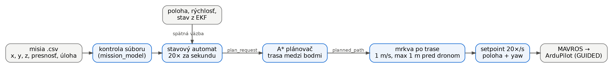
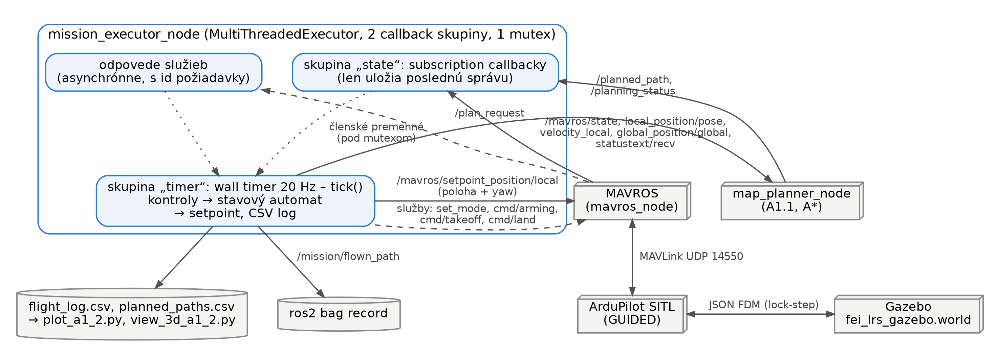
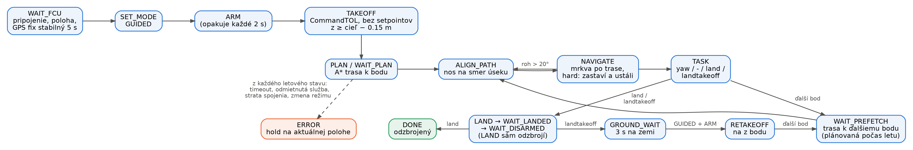
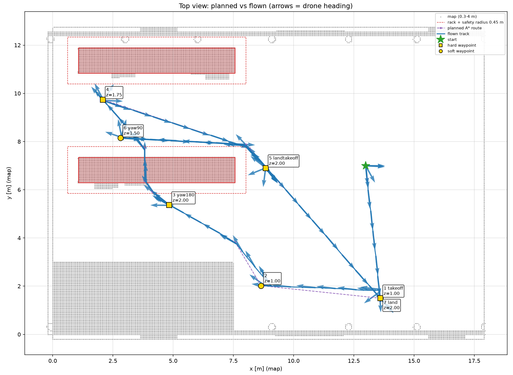
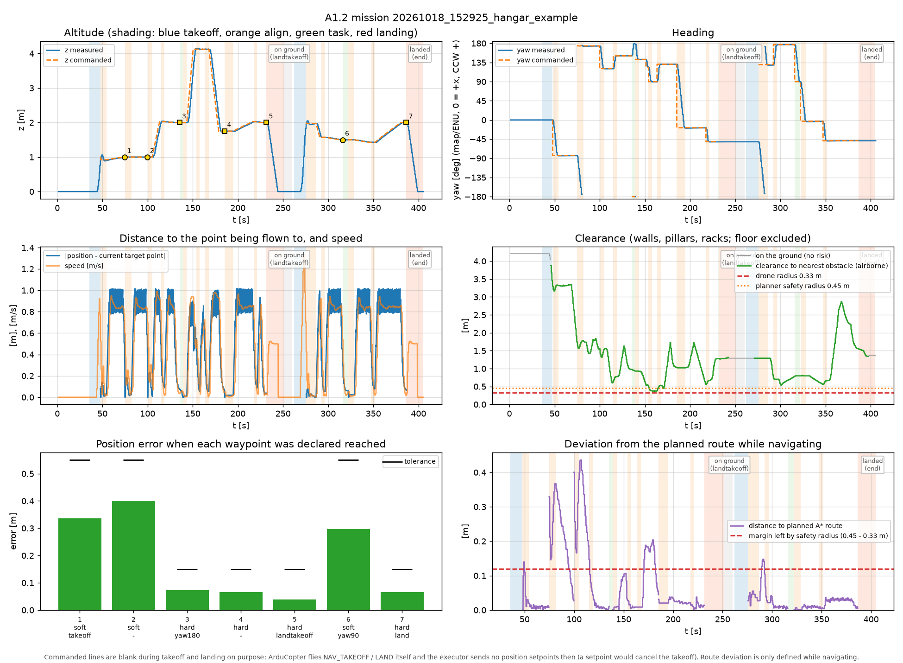
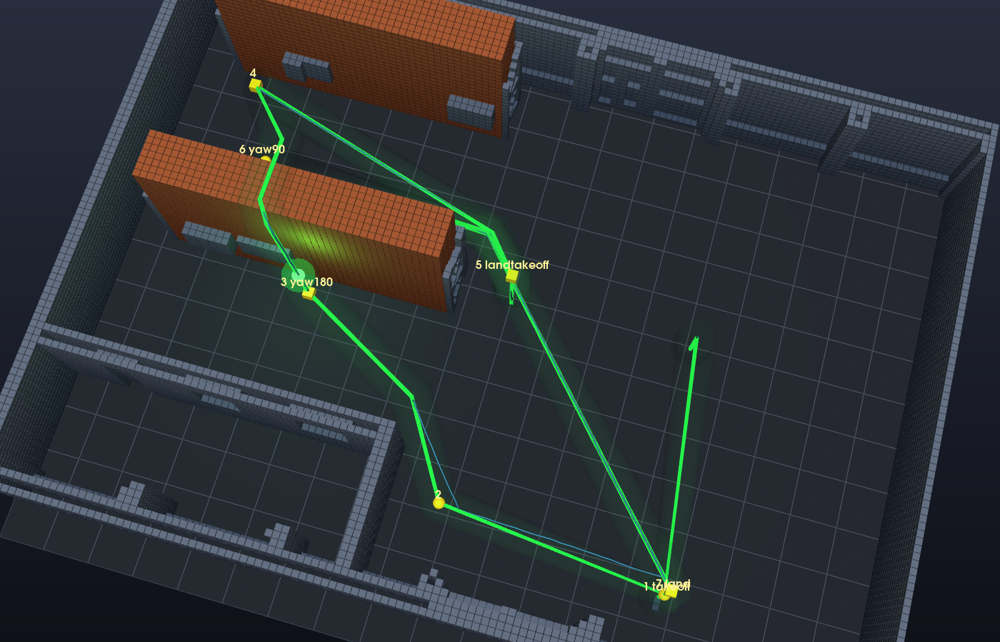

# A1.2 — Indoor misia v hangári (waypointy, úlohy, A*)

Dron v simulácii (ArduCopter SITL + Gazebo, cez MAVROS) preletí misiu zo súboru: vzlietne,
ku každému bodu si nechá naplánovať trasu algoritmom A* z A1.1, preletí ju s nosom v smere
letu, vykoná úlohu bodu a na konci pristane a odzbrojí sa. Všetko riadi uzol
`mission_executor_node` so stavovým automatom.

**Spustenie:** `./run_a1_2.sh [misia.csv]` (bez argumentu `missions/hangar_example.csv`), viac
v [HOW_TO_RUN.md](../../HOW_TO_RUN.md). **Záznam misie:** `results/hangar_example_20261018/`.

## Diagramy

**Tok dát:** misia obsahuje len cieľové body, trasu medzi nimi počíta A* a dron ju sleduje
pomocou „mrkvy“.

**ROS diagram:** dva uzly (plánovač, executor). Executor beží v `MultiThreadedExecutor` s dvomi
skupinami callbackov (vzor `mt_executor_demo`): subscription len uložia poslednú správu,
rozhoduje časovač 20 Hz. Zdieľané dáta chráni jeden mutex.

**Stavový automat:** prerušovaná šípka (ERROR) platí z každého letového stavu.

## Rozhodnutia

### Misia zo súboru

**Čo:** cesta k misii je ROS parameter `mission_file`, formát `x,y,z,presnosť,úloha`
(`hard`/`soft`; úloha `-`, `takeoff`, `land`, `landtakeoff`, `yaw<uhol>`), `#` je komentár.
Zlý počet polí, nečíslo alebo neznáma úloha zastaví uzol ešte na zemi s číslom riadku.

**Prečo:** na obhajobe dostaneme neznámy súbor, preklep musí skončiť jasnou chybou, nie
čudným letom.

### Súradnice a konvencia yaw

| Čo | Rámec |
|---|---|
| misia, plánovač, grafy (`map`) | rámec mapy a Gazeba: x = sever, y = západ, z hore |
| MAVROS lokálne | ENU (x = východ, y = sever), otočené o 90° voči `map` |
| ArduPilot vnútri | NED, prevod ENU ↔ NED robí MAVROS |

Prevod `map ↔ local` je otočenie o 90° okolo z (`map_to_local_yaw_offset_deg`), overené:
dron štartuje v Gazebe na (12.99, 7.00), MAVROS hlási (−7.00, 12.99).

**`yaw<uhol>`** je **absolútny** smer v rámci mapy v stupňoch, **kladne proti smeru hodinových
ručičiek**, 0° = os +x mapy. `yaw90` = nos na +y, `yaw-45` = 45° v smere hodinových ručičiek.

### Štart: pripravenosť, GUIDED, armovanie, vzlet

**Čo:** v `WAIT_FCU` čakáme na spojenie, lokálnu polohu a stabilný GPS fix (5 s). Služby
(set_mode, arming, takeoff, land) voláme asynchrónne, kontrolujeme odpoveď a ďalej ideme až
keď `/mavros/state` potvrdí skutočný stav; bez odpovede do 5 s → ERROR. Po armovaní pošleme
`NAV_TAKEOFF` a **žiadne polohové setpointy**, kým dron nevystúpi do 0.15 m od cieľovej výšky.
Ak sa na zemi odzbrojí, zopakujeme GUIDED → ARM → TAKEOFF (najviac 3×).

**Prečo:** odoslaná požiadavka neznamená prijatú. Polohový setpoint v GUIDED zruší rozbehnutý
vzlet a dron sa po 10 s na zemi sám odzbrojí (pôvodná chyba „zaarmuje a nevzlietne“).
Hlášky ArduPilota (`PreArm: ...`) vypisujeme do nášho logu, takže dôvod odmietnutia je vidieť.

### Plánovanie a sledovanie trasy („mrkva“)

**Čo:** pre každý bod pošleme `plan_request` [poloha, bod]; počas letu už plánujeme ďalší úsek.
Trasu odmietneme, ak plánovač posunul cieľ ďalej, než je tolerancia bodu. Setpoint (mrkva) sa
posúva po priamke úseku rýchlosťou 1 m/s a nie je ďalej ako 1 m pred dronom. Medziľahlé body
trasy sa berú v okruhu 0.45 m (`pass_radius`) bez zastavenia.

**Prečo:** trasa A* je bezkolízna len na priamke. Keď sme posielali len koniec úseku, ArduPilot
letel s inými limitmi vodorovne a zvislo a od priamky sa odchýlil až o 0.56 m (napr. nad
regálom klesal skôr). Predplánovanie odstráni čakanie na A* na bodoch.

**Plusy / mínusy:** + dron ostane na trase, nezastavuje na medziľahlých bodoch. − Rýchlosť je
obmedzená na 1 m/s.

### Smer nosa

**Čo:** medzi bodmi letí dron nosom v smere úseku (`atan2(Δy, Δx)`). Pred trasou a v rohoch
ostrejších ako 20° sa najprv otočí na mieste (do 5° počas 0.5 s), miernejšie zákruty letí
plynule. Príkaz yaw je spojitý (unwrap): z 170° na −170° sa otočí o 20°, nie o 340°.

### Presnosť hard a soft

| | Tolerancia | Kedy je bod splnený |
|---|---|---|
| `hard` | 0.15 m | do 0.15 m **a** rýchlosť ≤ 0.2 m/s nepretržite 1 s |
| `soft` | 0.55 m | do 0.55 m, bez zastavenia |

**Prečo:** 0.15 m je v odporúčanom rozsahu 10–20 cm a v SITL sa spoľahlivo dosahuje (namerané
2.9–9.7 cm). Pri 0.55 m dron prejde bodom plynule. Podmienka „1 s ustálený“ vylučuje
preletenie bodu, ktoré by trvalo len jednu vzorku. Bezpečnú vzdialenosť od prekážok nerieši
tolerancia, ale `safety_radius` plánovača.

### Úloha yaw

**Čo:** na bode sa cieľový yaw nastaví na zadaný uhol, splnené, keď je nos do 5° od cieľa
nepretržite 0.5 s; poloha sa drží. Uhol posielame v polohovom setpointe, ktorý je v GUIDED
zapamätaný (rýchlostným príkazom by vypršal `GUID_TIMEOUT`).

### Pristátie a landtakeoff

**Čo:** `cmd/land` prepne do LAND. Po dotyku (z ≤ 0.15 m, rýchlosť ≤ 0.15 m/s) čakáme, kým LAND
**sám odzbrojí** dron; vlastný príkaz na odzbrojenie pošleme až po 5 s. Pri `landtakeoff` potom
3 s počkáme, znova prepneme na GUIDED, zaarmujeme a vzlietneme na výšku bodu.

**Prečo:** ArduPilot prijme odzbrojenie, až keď jeho detektor pristátia potvrdí dotyk. Pôvodný
kód bral odmietnutie ako chybu a misia skončila na bode landtakeoff.

### Chyby a bezpečnosť

- **ERROR:** timeout stavu, odmietnutá služba, strata spojenia, poloha staršia ako 5 s,
  nečakané odzbrojenie → dron dostane ako cieľ svoju aktuálnu polohu a visí.
- Ak niekto počas letu prepne režim mimo GUIDED, misia sa zastaví (nebojujeme s pilotom).
- **Pomalá simulácia** (Gazebo 0.2–0.3× reálneho času): skript zmeria pomer a časové limity
  executora vynásobí, rýchlosť mrkvy vydelí.
- **Kontrola kolízií po lete:** `plot_a1_2.py` pre každú polohu spočíta vzdialenosť k najbližšej
  prekážke (steny, stĺpy, strecha, regály; podlaha nie) a porovná ju s polomerom drona 0.33 m.

## Výsledky (simulácia)

Všetky misie prebehli bez zásahu od štartu po odzbrojenie. Lety boli nahrané so
`safety_radius` 0.45 m; odovzdaná konfigurácia používa 0.30 m (rovnako ako A1.1).

| Misia | Body | Výsledok | Chyba hard bodov | Chyba soft bodov | Najmenší odstup |
|---|---:|---|---:|---:|---:|
| `hangar_example.csv` (záznam) | 7 | DONE, odzbrojený | 3.9–7.3 cm | 0.30–0.40 m | 0.37 m |
| `test_east_aisle.csv` | 8 | DONE, odzbrojený | 2.9–7.0 cm | 0.07–0.34 m | 0.61 m |
| `test_over_racks.csv` | 7 | DONE, odzbrojený | 5.0–7.6 cm | 0.30–0.35 m | 0.38 m |

`hangar_example` trval 404 s pri rýchlosti simulácie ~0.3; A* viedol úsek k bodu 4 ponad regál
(z ≈ 4.1 m).

Prerušené čiary v grafoch nie sú chýbajúce dáta: počas vzletu, pristátia a na zemi executor
zámerne neposiela setpoint.

## Čo nefunguje dokonale

- **Malá rezerva nad regálom:** najmenší odstup 0.37–0.38 m, len 4–5 cm nad polomerom drona
  (zaokrúhlenie voxelov v A1.1, pri klesaní dron ~0.15 m pod trasou). Väčší `safety_radius`
  pridá rezervu, ale zablokuje body misie blízko prekážok.
- **Po soft bode** začína ďalší úsek v strede bodu, takže prvý meter je dron až 0.4 m od
  nakreslenej trasy (v otvorenom priestore).
- **Krátke zastavenia v ostrých rohoch** (> 20°) kvôli otočeniu nosa.
- **Gazebo nesmie byť pozastavené:** SITL beží s Gazebom v lock-stepe, ⏸ zastaví ArduPilot
  a misia skončí v ERROR.
