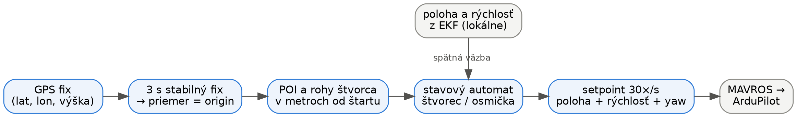
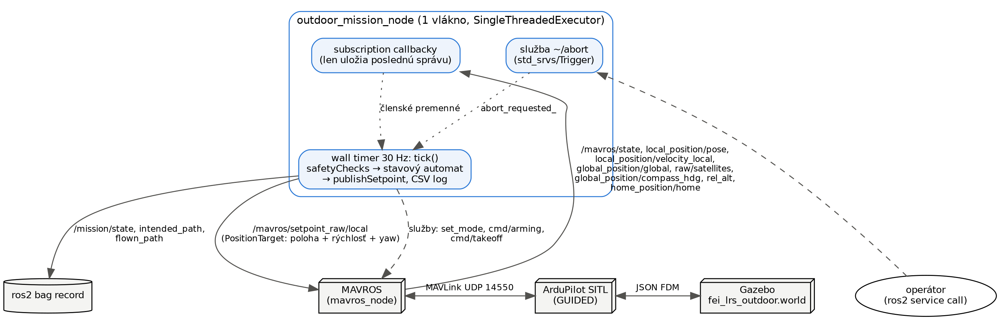
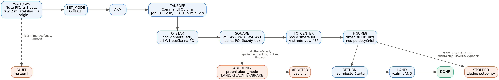
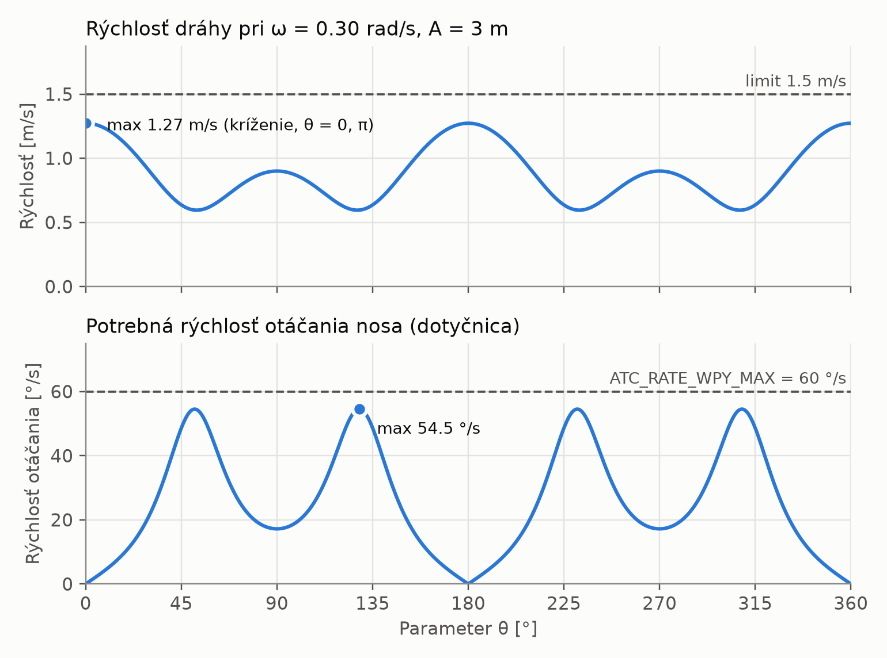
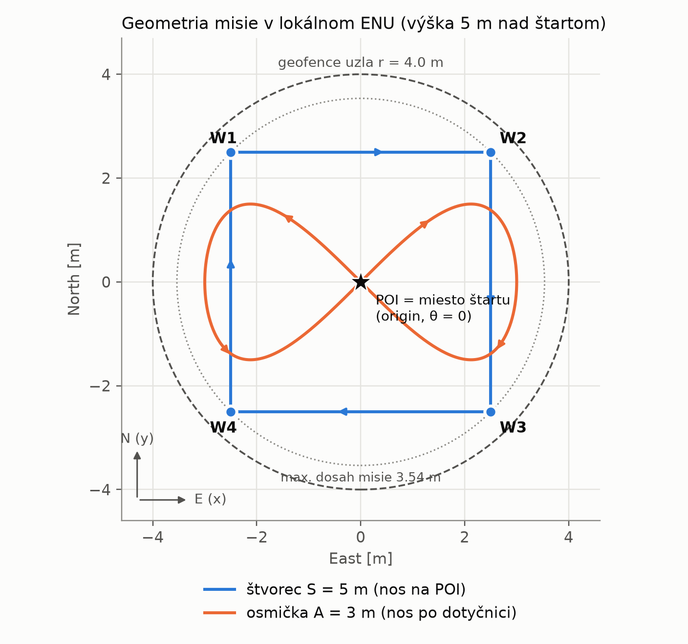
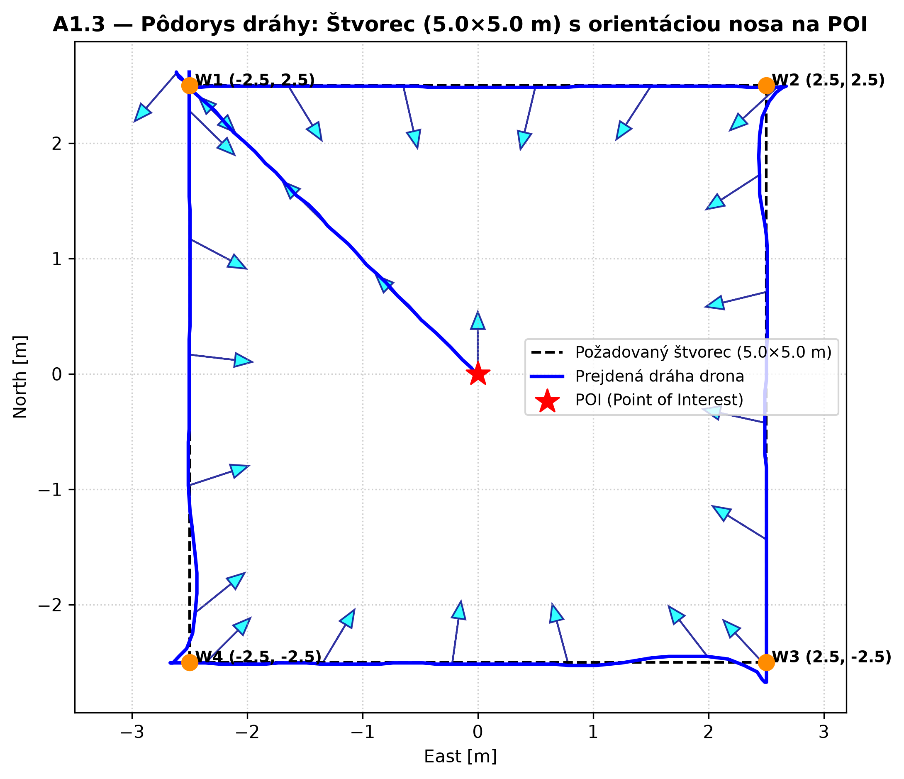
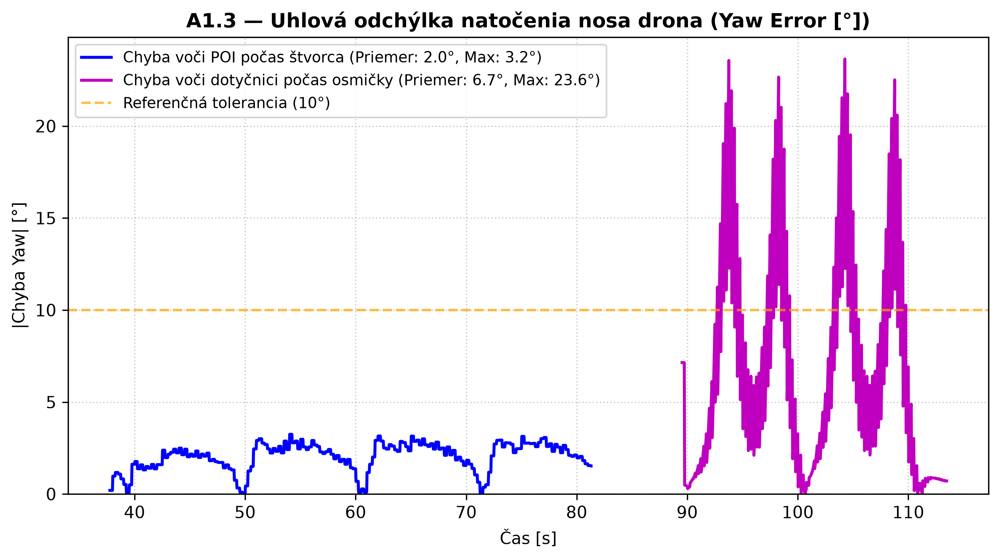

# A1.3 — Outdoor misia (GPS, kompas, osmička)

Dron vzlietne na 5 m, preletí štvorec 5 × 5 m s nosom stále otočeným na bod v strede (POI),
potom preletí osmičku a pristane tam, kde štartoval. Všetko robí jeden uzol
`outdoor_mission_node`. Výpočty (prevody súradníc, uhly, osmička) sú oddelené v súbore
`outdoor_math.h` a overené testom.

**Spustenie:** `./run_a1_3.sh --record`. Po pristátí sa stlačí Ctrl+C a záznam s grafmi sa
uloží do `results/A1_3/`. Rozmery sa dajú zmeniť napríklad cez `--square 4 --amplitude 2.5`.
**Abort:** `ros2 service call /outdoor_mission_node/abort std_srvs/srv/Trigger`

## Diagramy

**Tok dát:** z GPS sa raz na začiatku urobí origin, z neho sa vypočítajú body misie v metroch
a potom už dron letí podľa lokálnej polohy.



**ROS diagram:** jeden uzol v jednom vlákne. Callbacky si len uložia poslednú správu a
všetko riadenie robí jeden časovač 30× za sekundu. Vďaka tomu nemusíme riešiť súbežný prístup
k dátam.



**Stavový automat:** prerušované šípky (abort, prevzatie pilotom) platia z každého letového
stavu.



## Rozhodnutia

### Čakanie na GPS a origin

**Čo:** pred vzletom čakáme, kým má GPS fix aspoň 8 satelitov a presnosť do 2 m, a to bez
prerušenia 3 sekundy. Zo všetkých fixov počas týchto 3 s spravíme priemer. To je náš origin
(miesto štartu) a všetko ostatné je v metroch od neho. V kóde nie je žiadna pevná GPS
súradnica.

**Prečo:** vonku sa GPS chvíľu ustaľuje. V našom zázname prvé 2 s fix nebol a dron naozaj
čakal. Priemer je presnejší ako jeden náhodný fix.

**Plusy / mínusy:** + misia funguje na akomkoľvek mieste, + šum jedného fixu nepokazí celú
misiu. − Štart sa predĺži o ~3 s. − Ak GPS „uletí“ práve počas priemerovania, posunie sa celá
misia.

### Prevod GPS ↔ metre

**Čo:** používame plochú aproximáciu Zeme. Rozdiel zemepisnej šírky a dĺžky vynásobíme
polomerom Zeme v mieste štartu a dostaneme metre na východ a na sever. Funguje to aj opačne,
takže vieme vypísať, kde sme leteli, v lat/lon.

**Prečo:** misia má priemer pod 8 m. Overili sme to proti presnému prevodu: na 50 m je chyba
0.25 mm a na našej misii ~0.003 mm, teda státisíckrát menej ako šum GPS (~1 m). Knižnica
GeographicLib by nič nezlepšila.

**Plusy / mínusy:** + jednoduché, bez ďalšej knižnice. − Na vzdialenosti v kilometroch by
chyba narastala (na 500 m už 2.5 cm).

Dôležité: GPS používame **iba na origin**. Samotný let riadime podľa lokálnej polohy
z ArduPilota, ktorá je hladká. Šum GPS preto nespôsobuje trhanie.

### Uhly a výška

| Čo | Ako sa meria |
|---|---|
| yaw v našom kóde a v MAVROS | ENU: 0° = východ, kladne proti smeru hodinových ručičiek |
| kompas (`compass_hdg`) | 0° = sever, kladne v smere hodinových ručičiek |
| ArduPilot vnútri | NED, prevod ENU ↔ NED robí MAVROS za nás |

Prevod kompasu: **yaw_ENU = 90° − kurz** (a zalomíme do ±180°). Overili sme to: na štarte
ukazoval kompas 0° (sever) a yaw 90°. Počas letu sa oba zdroje po prevode líšili v priemere
o 0.14°.

**Výška:** „5 m“ znamená 5 m nad miestom štartu. Riadime lokálnu výšku z ArduPilota
(štartová výška + 5 m). Kontrolujeme aj `rel_alt` (výška nad home), ktorá sa líšila najviac
o 1 cm. GPS výšku nad morom (~194 m) iba vypisujeme.

### Vzlet

**Čo:** pošleme príkaz takeoff na 5 m a čakáme, kým je dron do 20 cm od cieľa a takmer stojí,
a to 2 s v kuse.

**Prečo:** zadanie zakazuje čakať pevný čas. Takto vieme naisto, že dron je hore a stabilný.

**Plusy / mínusy:** + spoľahlivé. − Pri vetre môže potvrdenie trvať dlhšie (máme timeout 40 s).

### Pohyb po štvorci

**Čo:** dron neposielame rovno do rohu, ale posúvame pred ním bod (tzv. mrkvu), za ktorým letí.
Mrkva sa rozbieha a brzdí plynulo (najviac 0.5 m/s²). Okrem polohy
posielame aj rýchlosť mrkvy, aby dron nezaostával.

**Prečo:** keď mrkva v rohu zastala naraz a hneď vyrazila do strany, dron sa v rohoch prudko
nakláňal („dipoval nosom“). Plynulý rozbeh to odstránil a strana sa predĺžila len asi o 1 s.
Bez posielania rýchlosti dron zaostával o ~0.8 m, teraz o ~0.1 m.

**Plusy / mínusy:** + plynulý let a presné rohy. − V každom rohu dron na chvíľu zastaví.

### Nos na POI počas štvorca

**Čo:** v každom ticku (30× za sekundu) spočítame smer z drona na POI a otočíme tam nos.
Smer počítame z miesta, kde dron bude o 0.5 s, aby sme vyrovnali oneskorenie otáčania.
Riadime len yaw, sklon kamery nie (kamera je pevná a gimbal nemáme). Uhol pohľadu nadol
(54–64°) iba zapisujeme do logu.

**Prečo:** smer na POI sa mení stále, najrýchlejšie v strede strany. Keby sme ho nastavili
len v rohoch, nos by mieril vedľa. Dron preto letí bokom a dozadu, ako chce zadanie.

**Plusy / mínusy:** + chyba len max 3.3°. − Predikcia 0.5 s je odhad oneskorenia ArduPilota;
na reálnom drone môže byť iné a treba ju doladiť.

### Smer nosa pri presunoch a otáčanie bez skokov

Pri presunoch (štart → W1, W1 → stred, návrat) letí dron nosom dopredu a otočí sa až tesne
pred cieľom. Pri otáčaní vždy volíme kratšiu cestu a príkaz yaw držíme spojitý: neskočí
z +180° na −180°, ale pokračuje napríklad na 190°. Tým sa dron nikdy neotočí o celé kolo
nesprávnym smerom.

### Osmička

**Čo:** žiadne waypointy. Časovač 30× za sekundu vypočíta z času parameter θ a z neho bod
na krivke: x = A·sin θ, y = A·sin θ·cos θ (stred na POI). Posielame polohu, rýchlosť aj yaw.
Prvé a posledné 3 s sa rýchlosť plynule zvyšuje a znižuje. Pred štartom osmičky dron preletí
do stredu, zastaví a otočí nos správnym smerom.

**Prečo:** začiatok aj koniec osmičky je v strede krivky, kde je dron najrýchlejší. Tvrdý
štart alebo koniec by znamenal skok z 0 na 1.27 m/s alebo naopak.

**Voľba ω:**

```
najvyššia rýchlosť = A · ω · √2      (v strede, kde sa krivka kríži)
limit 1.5 m/s  →  ω ≤ 1.5 / (3 · √2) = 0.35 rad/s
zvolili sme ω = 0.30 rad/s  →  max 1.27 m/s, jedno kolo za 21 s (+ 3 s rozbeh a dobeh)
```

Prečo nie 0.35: na koncoch slučiek sa musí nos otáčať veľmi rýchlo. Pri ω = 0.30 je to
54.5 °/s, pri 0.35 by to bolo 64 °/s, čo je viac ako predvolený limit ArduPilota (60 °/s).



**Geofence:** osmička má 6 × 3 m a celá sa zmestí do štvorca. Najďalej od štartu sú rohy
štvorca (3.54 m). Náš limit je 4 m od štartu a 5.5 m výšky. Uzol si to pred letom prepočíta
a ak by sa misia nezmestila, odmietne vzlietnuť.



### Nos po dotyčnici

**Čo:** smer nosa = smer pohybu po krivke, teda yaw = atan2(cos 2θ, cos θ). Rovnako ako pri
POI ho vyhodnocujeme o kúsok dopredu a držíme spojitý. Posielame uhol, nie rýchlosť otáčania.

**Prečo uhol:** pri rýchlosti otáčania by sa malé chyby sčítavali a nos by sa postupne
odchýlil. Uhol sa vždy opraví sám. V strede krivky prechádza dron dvakrát rôznym smerom
(45° a −45°).

**Plusy / mínusy:** + žiadne otočky ani cuknutia. − Na koncoch slučiek nos zaostáva až o ~24°,
lebo potrebné otáčanie je blízko limitu ArduPilota.

### Pristátie, abort a bezpečnosť

- Po osmičke dron preletí nad miesto štartu a prepne sa do režimu LAND.
- **Abort:** služba `~/abort` prepne dron do LAND (alebo RTL, LOITER, BRAKE podľa
  parametra). Abort spustí aj prekročenie vlastného geofence alebo to, že dron je od
  setpointu ďalej ako 2 m.
- **Nebojujeme s pilotom:** keď pilot prepne režim z ovládača, dron sa odzbrojí alebo vypadne
  MAVROS, uzol prestane posielať príkazy a nič neprepína.

## Výsledky (simulácia)

Záznam je v `results/A1_3/run_20261017_212049/` (rosbag, CSV log, grafy). Misia preletela bez
zásahu dvakrát po sebe.

| | Priemer | Najhoršie |
|---|---:|---:|
| Štvorec: nos voči smeru na POI | 2.0° | 3.3° |
| Štvorec: odchýlka od dráhy | 0.09 m | 0.31 m |
| Osmička: odchýlka od dráhy | 0.18 m | 0.40 m |
| Osmička: nos voči požadovanému smeru | 6.7° | 23.7° |
| Výška počas misie | 5.00 m | 4.99–5.00 m |
| Najďalej od štartu | — | 3.71 m (limit 4 m) |





