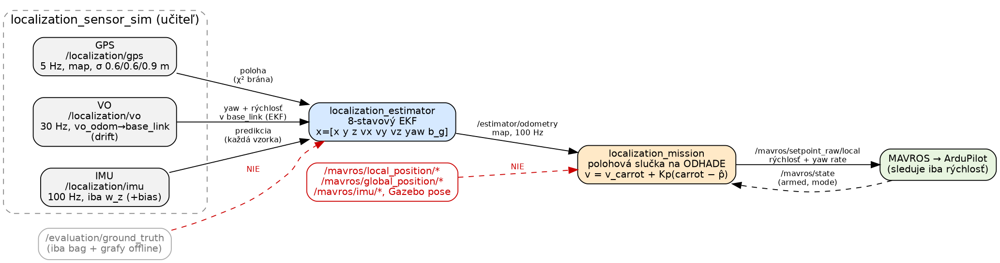
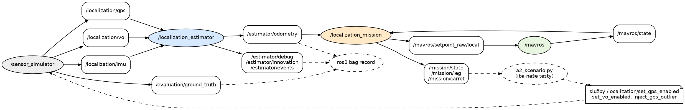
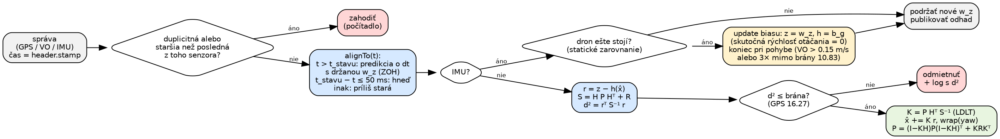
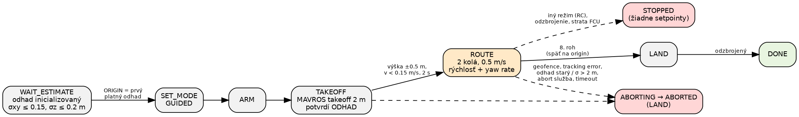
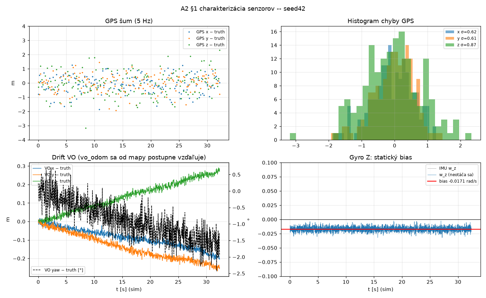
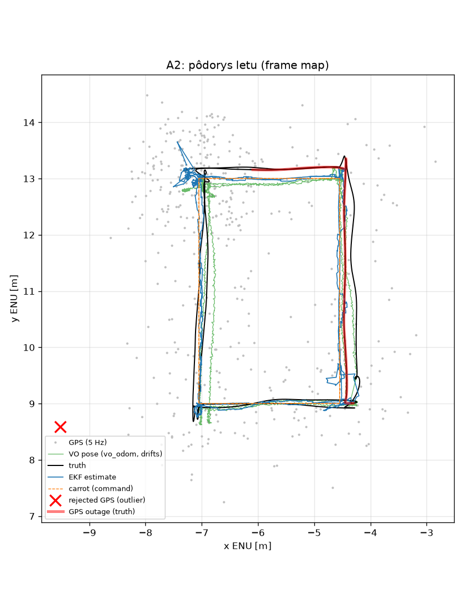
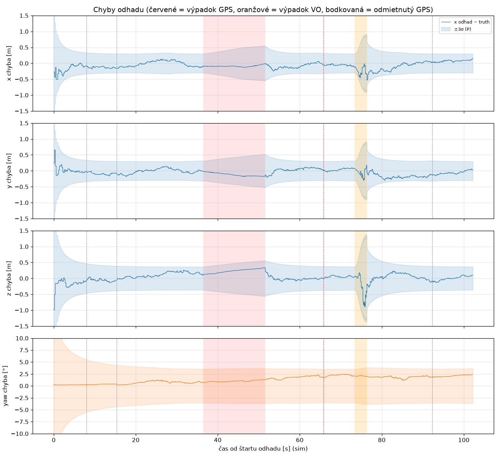
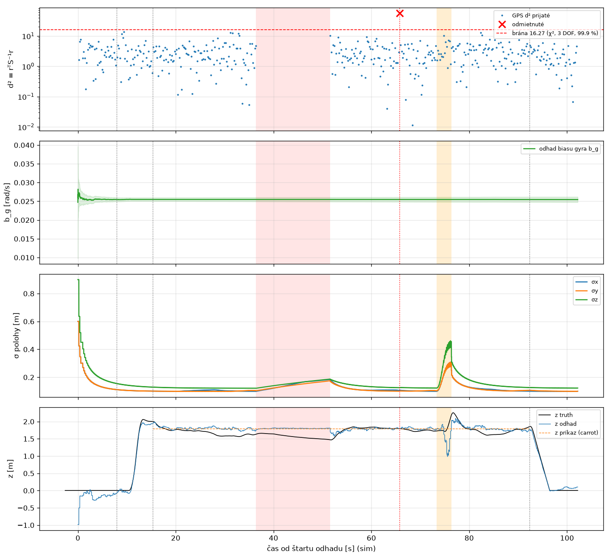

# A2 — Lokalizácia dronu Kalmanovým filtrom (EKF)

Dron má tri senzory a každý je trochu pokazený:

- **GPS** ukazuje polohu, ale skáče (šum ~0.6 m).
- **Vizuálna odometria (VO)** ukazuje pohyb a natočenie, ale postupne sa posúva preč od skutočnosti.
- **Gyroskop** meria otáčanie, ale má skrytú chybu (bias), ktorú nepoznáme.

Náš filter (EKF) spojí všetky tri do jedného odhadu, kde dron je a kam sa pozerá. Dron potom
letí **iba podľa tohto odhadu**: vzlietne na 2 m, preletí dvakrát obdĺžnik 2.5 × 4 m s nosom
v smere letu a pristane. Polohu z MAVROS ani z Gazeba nepoužívame.

Kód je rozdelený na tri časti:

- `ekf8.h`: samotný filter (iba matematika, bez ROS),
- `localization_estimator_node`: ROS uzol, ktorý filtru dáva správy zo senzorov a publikuje odhad,
- `localization_mission_node`: riadi let podľa odhadu.

**Spustenie:** `./run_assignment2.sh` (otvorí okná a živý dashboard).
Automatický let s výpadkami senzorov, záznamom a grafmi: `./run_assignment2.sh --record --scenario --video`,
výsledky sa uložia do `results/A2/<beh>/`. Iný seed: `--seed 73`. Celé zadanie naraz:
`./run_assignment2.sh --all`.
**Výstup:** `/estimator/odometry` (`nav_msgs/Odometry`, 100 Hz, frame `map`).
**Abort:** `ros2 service call /localization_mission/abort std_srvs/srv/Trigger`

## Diagramy

**Tok dát:** filter číta iba tri topicy zo senzorov (GPS, VO, IMU). Riadenie číta iba náš odhad
a posiela do MAVROS rýchlosť. Skutočnú polohu (ground truth, červené čiary) používajú iba grafy.

**ROS graf:** oba naše uzly bežia v jednom vlákne, takže sa nemusíme starať o súbežný prístup
k dátam. `a2_scenario.py` iba hrá „učiteľa“: vypína senzory a posiela chybné GPS.

**Spracovanie jednej správy:** filter najprv posunie odhad na čas správy a až potom ju použije.

**Stavový automat misie:** prerušované šípky (abort, prevzatie pilotom) platia z každého
letového stavu.

## Ako sa správajú senzory

Najprv sme 30 s nahrávali stojaci dron (seed 42, seed 73 a znova seed 42) a pozreli sa, aké
chyby senzory naozaj majú.

| | seed 42 | seed 73 | seed 42 (znova) |
|---|---|---|---|
| frekvencia GPS / VO / IMU | 5 / 30 / 100 Hz | 5 / 30 / 100 Hz | 5 / 30 / 100 Hz |
| šum GPS (x, y, z) | 0.62, 0.61, 0.87 m | 0.62, 0.54, 0.78 m | 0.61, 0.67, 0.89 m |
| **bias gyra** | **−0.0171 rad/s** | **−0.0238 rad/s** | **−0.0171 rad/s** |
| posun natočenia VO | −3.0 °/min | +0.05 °/min | −2.6 °/min |

Čo sme zistili:

- **Simulácia beží pomalšie ako reálny čas.** Preto `ros2 topic hz` ukáže menej (~3 / 18 / 61 Hz).
  Čas preto berieme vždy z časovej značky v správe, nie z hodín počítača.
- **Rovnaký seed dá rovnaký bias**, iný seed iný. Filter preto bias musí zistiť sám.
- **Poloha z VO uteká** (~1 cm/s) a natočenie z VO tiež (až 3° za minútu). Bias gyra by bez
  opravy spôsobil chybu natočenia ~90° za 90 s.

## Rozhodnutia

### Čo filter odhaduje

**Čo:** 8 čísel: poloha (x, y, z), rýchlosť (vx, vy, vz), natočenie (yaw) a bias gyra.
Pri každej správe z IMU (100× za sekundu) filter posunie polohu podľa rýchlosti a otočí yaw
podľa gyra (po odčítaní biasu). Zároveň si pamätá, ako veľmi si je každým číslom istý
(kovariancia). Čím dlhšie nepríde meranie, tým menej si je istý.

**Prečo:** IMU chodí najčastejšie, takže je to prirodzený takt. Rýchlosť považujeme za
konštantnú, lebo akcelerometer zadanie nedovoľuje použiť. Zmeny rýchlosti doženú merania.

### Správy chodia v rôznom poradí

**Čo:** každú správu použijeme hneď, ako príde. Filter si najprv dopočíta, kde dron bol v čase
správy, a potom ju použije. Ak príde správa trochu neskoro (do 50 ms), použijeme ju aj tak,
chyba je pár milimetrov. Staršie správy zahodíme.

**Prečo:** zadanie nedovoľuje čakať, kým prídu všetky senzory naraz.

### Čo berieme z ktorého senzora

| senzor | čo z neho berieme | ako veľmi mu veríme |
|---|---|---|
| GPS | polohu | podľa presnosti v správe (0.6 m, výška 0.9 m) |
| VO | rýchlosť a natočenie | menej, ako tvrdí správa (rýchlosť 0.2 m/s, natočenie 0.5 rad) |
| gyro | rýchlosť otáčania | na zemi navyše na zistenie biasu |

**Polohu z VO nepoužívame**, lebo postupne uteká. Rýchlosť z VO je však dobrá a drift sa v nej
nehromadí. Natočenie z VO je jediné meranie, ktoré hovorí, kam sa dron naozaj pozerá.

Rýchlosť z VO je meraná v smere dronu (dopredu, doboku), nie v smere mapy. Filter ju preto
porovnáva s vlastným odhadom otočeným o yaw. Vďaka tomu pomáha opravovať aj natočenie.

**Prečo menej dôverujeme VO:** správa hovorí, že VO je veľmi presná, ale jej chyba sa pomaly
nahromadí. Keď sme VO verili podľa správy, filter si myslel, že je presný na 6 cm, ale chyboval
o 30 cm. S nižšou dôverou je chyba menšia a filter vie, ako veľmi sa môže mýliť.

### Bias gyra: zistíme ho ešte na zemi

**Čo:** kým dron stojí na zemi, vieme, že sa neotáča. Všetko, čo gyro vtedy ukazuje, je teda
bias (plus trochu šumu). Filter ho tak zmeria ešte pred vzletom. Keď sa dron pohne, toto
meranie sa vypne a ďalej bias drží natočenie z VO.

**Prečo:** keby sme bias zisťovali iba z VO, prevzal by aj jej drift. Takto je bias presný
(±0.0003 rad/s) a chyba natočenia klesla z 1.56° na 1.0°.

### Začiatok filtra

Filter čaká na prvé GPS a prvú VO. Poloha = prvé GPS, natočenie = prvé natočenie z VO
(VO začína zarovnaná s mapou), rýchlosť a bias = 0. V kóde nie je žiadna pevná poloha.

### Ladenie bez simulátora

**Čo:** `tools/a2_offline_sim.py` vymyslí let a pokazí senzory **rovnakým kódom, aký používa
učiteľov simulátor**. Výsledok pošle cez náš filter a porovná so skutočnosťou. Jeden beh trvá
sekundy namiesto minút, tak sme vedeli porovnať nastavenia na 20 seedoch.

| nastavenie (20 seedov, výpadok GPS 15 s, chybné GPS, výpadok VO 3 s) | chyba polohy | chyba natočenia |
|---|---:|---:|
| **finálne** | **0.21 m** | **1.0°** |
| bez zistenia biasu na zemi | 0.22 m | 1.45° |
| VO s dôverou podľa správy | 0.32 m | 1.26° |
| bez natočenia z VO | 0.23 m | 1.64° |

Plné výsledky: `results/A2/offline/offline_20_seeds.txt`.

### Chybné GPS (outlier)

**Čo:** pri každom GPS sa filter spýta: „Aké veľké odchýlky očakávam?“ Ak je meranie ďaleko
od toho, čo čakal, a to aj s ohľadom na to, ako si je sám istý, meranie zahodí a zapíše to do logu.
Hranica je zvolená tak, že dobré GPS sa zahodí iba v 1 z 1000 prípadov. Ak by sa zahodilo 5 GPS
po sebe, ďalšie sa prijme, aby filter nezostal zaseknutý.

**Prečo:** zadanie nechce pevnú vzdialenosť. Po výpadku GPS si je filter menej istý a hranica sa
sama rozšíri. Chybné GPS (aspoň 5 m vedľa) bolo vo všetkých letoch jasne odmietnuté.

### Výpadky GPS a VO

**Čo:** pri výpadku sa nič neresetuje. Filter počíta ďalej s tým, čo má, a je si menej istý.
Bez GPS vedú polohu VO a gyro, bez VO vedie polohu GPS. Do logu sa raz zapíše `GPS LOST` a po
návrate `GPS BACK after 15.2 s gap … no reset`.

**Prečo:** po návrate GPS sa odhad neposunie naraz, ale postupne. V lete bolo prvé GPS po
výpadku 1.4 m vedľa a odhad sa pohol iba o 0.1 m. Ďalšie merania ho dotiahli.

### Dron letí podľa nášho odhadu

**Čo:** misia porovná, kde má dron byť (bod pred dronom, ako v A1.3) a kde podľa odhadu je,
a z rozdielu vypočíta rýchlosť. Do MAVROS posiela **iba rýchlosť a rýchlosť otáčania**, nie
polohu. Bod pred dronom sa hýbe 0.5 m/s a plynulo sa rozbieha.

**Prečo:** keby sme posielali polohu, ArduPilot by ju porovnával so **svojím** odhadom polohy.
Takto o polohe rozhoduje iba náš filter.

### Natočenie v smere letu

Na každej strane obdĺžnika sa dron pozerá dopredu. V rohu sa najprv otočí (kratšou cestou) a až
potom letí ďalej. Za jedno kolo sa otočí o 360° a pri lete na západ prejde cez hranicu
+180° / −180°. Tak sme overili, že filter si s touto hranicou poradí aj počas letu.

### Keď je odhad horší, dron spomalí

**Čo:** misia vidí, ako si je filter istý polohou. Keď je neistota malá, letí normálne. Keď
narastie, spomalí, a keď je veľká, zastaví a čaká. To sa stane pri výpadku VO, výpadok GPS dron
nespomalí.

**Prečo:** bez VO odhad skáče s každým GPS a dron by skákal s ním. Keď stojí, ArduPilot ho
podrží na mieste a po návrate VO pokračuje.

### Vzlet, pristátie, bezpečnosť

- **Štart misie:** keď si je filter polohou dosť istý (~8 s na zemi). Od tohto bodu sa počítajú
  rohy obdĺžnika aj výška 2 m.
- **Vzlet** robí ArduPilot. Hotový je, keď **náš odhad** ukazuje 2 m a dron stojí 2 s.
- **Pristátie:** po dvoch kolách sa prepne na LAND.
- **Abort (LAND):** keď neprichádza odhad, filter si je príliš neistý, dron vyletí mimo
  povolenú oblasť (6 m od štartu, 3.5 m výška), je ďaleko od cieľa alebo sa zavolá `abort`.
- **Pilot má prednosť:** keď pilot prepne režim, uzol prestane posielať príkazy (ako v A1.3).

## Výsledky (simulácia)

Pri každom lete „učiteľ“ (`--scenario`) vypne GPS na 15 s, pošle chybné GPS a vypne VO na 3 s.
Pri náhodnom scenári (`--scenario-random 11`) sa časy vyžrebujú. Po štarte nikto nezasahuje.

Let `seed5` je na **finálnom kóde** a v gite je aj so záznamom (bag). Ostatné lety sú zo staršej
verzie, kde sa dron neotáčal v smere letu (filter bol rovnaký), preto trvali kratšie.

<!-- RESULTS_TABLE_BEGIN -->
| beh | koniec | trasa | RMSE xy / z | max xy | RMSE yaw | xy / yaw v ±3σ | max chyba GPS výpadok | max chyba VO výpadok | outlier d² | pristátie od štartu |
|---|---|---:|---:|---:|---:|---:|---:|---:|---:|---:|
| `seed5` | DONE | 84 s | 0.17 / 0.16 m | 0.54 m | 1.57° | 100 / 100 % | 0.21 m (15 s) | 0.54 m (3 s) | 56 | 0.35 m |
| `seed42` | DONE | 67 s | 0.17 / 0.12 m | 0.76 m | 0.90° | 99 / 100 % | 0.22 m (15 s) | 0.76 m (3 s) | 66 | 0.17 m |
| `seed73` | DONE | 68 s | 0.18 / 0.08 m | 0.79 m | 1.57° | 99 / 100 % | 0.10 m (15 s) | 0.79 m (3 s) | 103, 16 | 0.35 m |
| `seed7` | DONE | 68 s | 0.18 / 0.16 m | 0.69 m | 0.52° | 100 / 100 % | 0.17 m (15 s) | 0.69 m (3 s) | 76 | 0.33 m |
| `seed123` | DONE | 67 s | 0.19 / 0.20 m | 0.65 m | 2.57° | 100 / 99 % | 0.35 m (15 s) | 0.65 m (3 s) | 73 | 0.43 m |
| `random11_seed73` | DONE | 68 s | 0.15 / 0.13 m | 0.69 m | 1.14° | 100 / 100 % | 0.24 m (15 s) | 0.69 m (3 s) | 86 | 0.17 m |

Scenáre: `seed5`, `seed42`, `seed73`, `seed7`, `seed123` — GPS off 15 s at leg 2 (+1.0 s), outlier at leg 5 (+1.0 s), VO off 3 s at leg 6 (+1.0 s); `random11_seed73` — GPS off 15 s at leg 6 (+2.3 s), outlier at leg 5 (+1.0 s), VO off 3 s at leg 2 (+2.0 s).
<!-- RESULTS_TABLE_END -->

**Zhrnutie:**

- Všetkých 6 letov doletelo do konca bez zásahu.
- Priemerná chyba polohy bola ~0.17 m a natočenia 0.5–2.6°.
- Chyba bola takmer vždy v rozsahu, ktorý filter sám odhadol (±3σ).
- Každé chybné GPS bolo zahodené. Pri seede 73 sa navyše zahodilo jedno obyčajné GPS tesne nad
  hranicou, čo pri ~400 GPS za let presne zodpovedá 1 z 1000.
- Bias zmeraný na zemi sa zhodoval s charakterizáciou na ±0.0003 rad/s:

| seed | bias gyra (charakterizácia) | bias odhadnutý filtrom |
|---|---:|---:|
| 42 | −0.0170 rad/s | −0.0171 rad/s |
| 73 | −0.0239 rad/s | −0.0238 rad/s |
| 7 | +0.0126 rad/s | +0.0125 rad/s |
| 123 | −0.0148 rad/s | −0.0149 rad/s |

### Let na finálnom kóde (seed 5)

Sivé body sú GPS, zelená je poloha z VO (vidno, ako uteká), čierna je skutočná dráha a modrá
náš odhad. Červený krížik je zahodené chybné GPS, červený úsek je dráha počas výpadku GPS.

Chyba odhadu v čase. Modrá plocha je rozsah, v ktorom si filter myslí, že sa nachádza chyba.
Počas výpadku GPS (červené) sa plocha zväčšuje, ale chyba ostáva malá. Pri výpadku VO (oranžové)
chyba na chvíľu narastie na 0.54 m, stále je však v odhadnutom rozsahu.

Hore: ako ďaleko bolo každé GPS od očakávania (červená čiara je hranica zahodenia). Pod tým
odhad biasu, ktorý sa ustáli do 3 s ešte na zemi, neistota polohy a výška.

Počas letu to isté ukazuje **živý dashboard** (`tools/a2_live.py`). **Video letu** vyrobí
`python3 tools/a2_video.py results/A2/<beh>/bag`.
