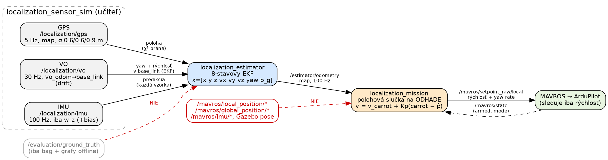
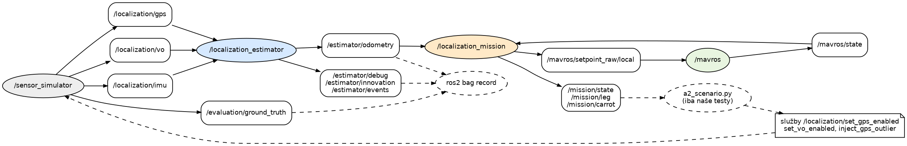
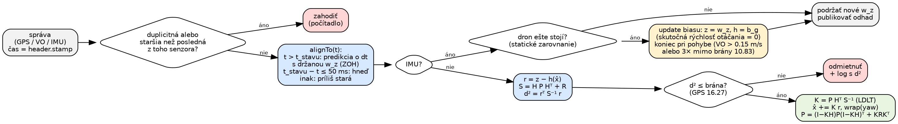
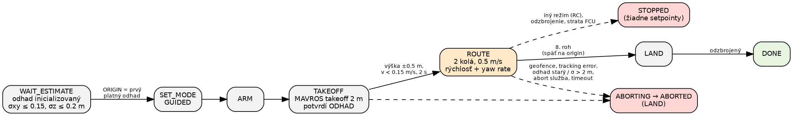
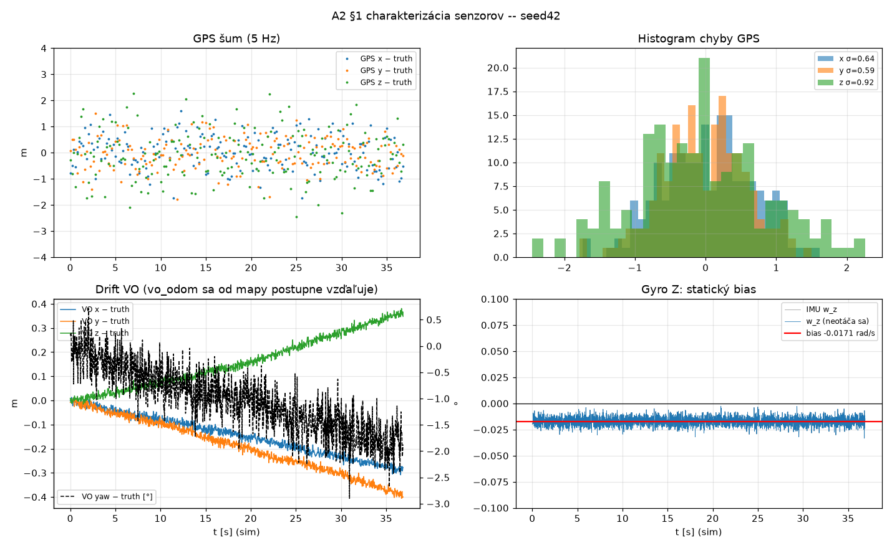
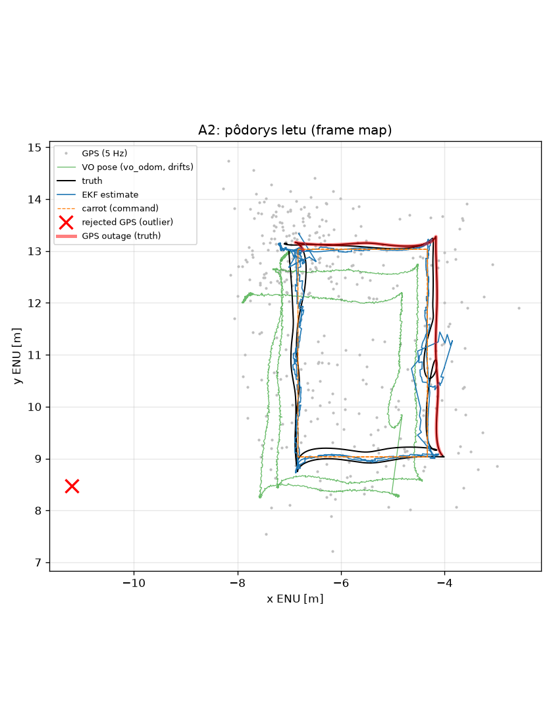
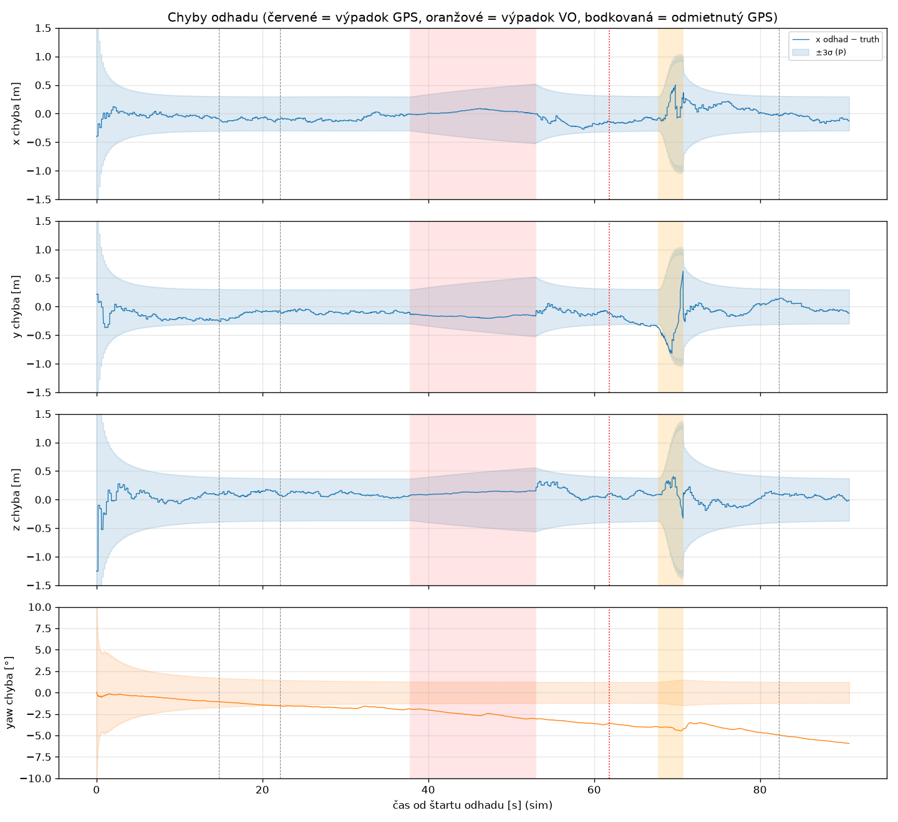
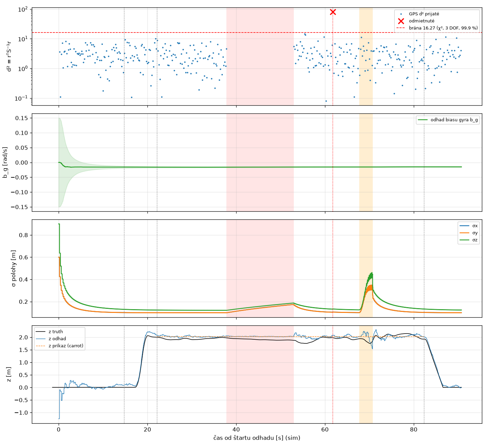

# A2 — Lokalizácia dronu jednoduchým Kalmanovým filtrom

Dron má tri zámerne nedokonalé senzory: GPS so šumom, vizuálnu odometriu (VO), ktorá sa
postupne posúva (drift), a gyroskop osi Z so skrytým statickým biasom. Náš 8-stavový EKF ich
spája do jedného odhadu polohy a natočenia. Dron potom podľa **tohto odhadu** vzlietne na
2 m, preletí dve kolá obdĺžnika 2.5 × 4 m a pristane. Lokalizačné výstupy MAVROS ani Gazeba
regulátor nepoužíva.

**Spustenie:** jeden skript spustí všetko naraz: `./run_assignment2.sh` (okná + živý dashboard
`tools/a2_live.py`, testy robí učiteľ ručne),
`./run_assignment2.sh --record --scenario --video` (automatický „učiteľ“, bag, grafy a video do
`results/A2/<beh>/`), `--headless` (bez okien; počká na pristátie a všetko zavrie). Iný seed: `--seed 73`.
**Celé zadanie od začiatku do konca:** `./run_assignment2.sh --all` (unit test, offline test, 3×
charakterizácia, lety na 4 seedoch + 1 náhodný scenár, grafy, video, tabuľka výsledkov nižšie).
Ručné príkazy sú v [README.md](../../README.md).
**Výstup odhadu:** `/estimator/odometry` (`nav_msgs/Odometry`, 100 Hz), frame `map` (ENU, ako
GPS a MAVROS), `child_frame_id` `base_link`.
**Abort:** `ros2 service call /localization_mission/abort std_srvs/srv/Trigger` (prepne na LAND).

## Diagramy

**Tok dát:** estimátor číta iba tri `/localization/` topicy. Regulátor číta iba náš odhad
a `/mavros/state`. Do MAVROS posiela rýchlosť a rýchlosť otáčania, nie polohu. Červené
(prerušované) cesty v systéme nie sú: ground truth číta iba bag a offline grafy.

**ROS graf:** `a2_scenario.py` je iba náš „učiteľ“ pre testovacie lety. Volá služby simulátora
senzorov, nikdy nie estimátor ani regulátor. Oba naše uzly sú jednovláknové, callbacky nikdy
nebežia súčasne a filter nepotrebuje mutex.

**Jedna správa vo filtri:** každá správa najprv posunie stav na svoj vlastný čas (predikcia)
a až potom sa použije.

**Stavový automat misie:** prerušované šípky platia z každého letového stavu.

## A2 §1 — Charakterizácia senzorov

Nahrali sme 30 s so stojacim dronom pre seed 42, seed 73 a znova seed 42
(`./run_assignment2.sh --characterize 30 --seed N`). Pohyb pokrýva bag z letu. Vyhodnotenie
(`tools/a2_characterize.py`) beží ako samostatný proces a ground truth číta iba z bagu.

| | seed 42 | seed 73 | seed 42 (znova) |
|---|---|---|---|
| frekvencie z hlavičiek (GPS / VO / IMU) | 5.0 / 30.0 / 100.0 Hz | 5.0 / 30.0 / 100.0 Hz | 5.0 / 29.9 / 99.7 Hz |
| frame GPS / VO / IMU | `map` / `vo_odom → base_link` / `base_link` | rovnaké | rovnaké |
| σ GPS − truth (x, y, z) | 0.62, 0.61, 0.87 m | 0.62, 0.54, 0.78 m | 0.61, 0.67, 0.89 m |
| **bias gyra Z** (dron sa neotáča) | **−0.0171 rad/s** | **−0.0238 rad/s** | **−0.0171 rad/s** |
| šum gyra Z | 0.0040 rad/s | 0.0041 rad/s | 0.0040 rad/s |
| drift VO yaw | −3.03 °/min | +0.05 °/min | −2.61 °/min |
| priemerná chyba VO rýchlosti (bias) | (−0.009, +0.006, +0.010) m/s | (+0.008, −0.002, +0.006) m/s | (−0.007, +0.009, +0.007) m/s |

Čo z toho vyplýva:

* **Frekvencie treba merať zo stampov.** Gazebo tu bežalo pomalšie ako reálny čas (real-time
  faktor 0.61). `ros2 topic hz` meria čas príchodu, preto ukáže len ~3.1 / 18 / 61 Hz. Stampy
  v simulačnom čase majú 5 / 30 / 100 Hz. Filter preto berie `dt` iba zo stampov.
* **Iný seed = iné poškodenie, rovnaký seed = rovnaké skryté parametre.** Bias gyra je pri
  oboch behoch so seedom 42 do 4. desatinného miesta rovnaký (−0.0171) a pri seede 73 iný
  (−0.0238). Drift VO sa pri rovnakom seede tiež zopakuje (−3.03 a −2.61 °/min, pri seede 73 +0.05). Prvá GPS vzorka
  je pri rovnakom seede identická, ďalšie už nie: GPS aj VO v simulátore zdieľajú jeden
  generátor náhodných čísel, ktorý čerpá pri každej správe truth (100 Hz, best effort). Jedna
  stratená správa pri záťaži posunie celú ďalšiu postupnosť šumu. Preto filter neladíme na jednu
  stopu šumu.
* **VO sa naozaj vzďaľuje od mapy** (~1 cm/s, yaw až ~3 °/min). Jej absolútna poloha teda nie je
  použiteľná ako GPS. Gyro má bias, ktorý by integrovaný za 90 s dal ~90° chybu, ak by sa
  neodhadoval.

## Rozhodnutia

### Filter v C++ s Eigen, matematika oddelená od ROS

**Čo:** celý filter (stav, predikcia, modely meraní, brána, inicializácia) je v jednom súbore
`ekf8.h`, ktorý nezávisí od ROS, iba od Eigen. Uzol `localization_estimator_node.cpp` len
prečíta správy, skontroluje frame a čas, zapíše logy a publikuje výstup. Ten istý kód beží
v teste `ekf8_test` a v offline prehrávaní `ekf8_replay`.

**Prečo:** filter vieme otestovať a naladiť bez simulátora (sekundy namiesto minút na let) a
na obhajobe ukážeme jedno miesto, kde je každý vzorec. C++ je rovnaký jazyk ako zvyšok
nášho balíka.

**Plusy / mínusy:** + test a ladenie na 20 seedoch za ~10 s, + istota, že offline aj ROS
počítajú to isté. − Ešte jeden súbor navyše, − Eigen šablóny majú dlhé chybové hlášky.

### Stav a predikcia

**Čo:** stav je presne podľa zadania `x = [x, y, z, vx, vy, vz, yaw, b_g]ᵀ` vo frame `map`.
Predikcia beží na každej vzorke IMU (100 Hz): poloha sa posunie o `v·dt` (konštantná rýchlosť),
`yaw += (w_z − b_g)·dt` a zabalí sa do [−π, π). Rýchlosť a bias sa nemenia, mení sa iba ich
neistota. Kovariancia: `P = F P Fᵀ + Q(dt)`. Matica `F` je presná, lebo model je v stave lineárny.
Jediný „krížový“ člen je `F(yaw, b_g) = −dt`. `Q` počítame zo spojitých hustôt šumu pre každé
`dt` zvlášť (pre os: `σa²·[dt³/3, dt²/2; dt²/2, dt]`).

**Prečo:** IMU je najrýchlejší senzor, takže predikcia na každej vzorke je prirodzený takt.
Spojité hustoty v `Q` znamenajú, že pri dlhšom `dt` (výpadok, štart) rastie neistota správne,
nielen raz za krok.

**Plusy / mínusy:** + jednoduché, presne odvodené, bez linearizačnej chyby v predikcii.
− Model nevie o zrýchlení (akcelerometer zadanie zakazuje), zmenu rýchlosti v rohoch musí
pokryť `Q` a merania. − Gyro meria rýchlosť okolo osi tela, nie presne yaw rate. Pri náklone
~5° je rozdiel malý a kryje ho rezerva v `Q`.

### Časovanie: stampy a asynchrónne aktualizácie

**Čo:** každá správa nesie svoj `header.stamp` (simulačný čas). Filter ju použije hneď, ako
príde: najprv `alignTo(t)` predikuje stav na čas správy (s posledným podržaným `w_z`),
potom urobí update. Ak je správa staršia ako stav najviac o 50 ms (prišla tesne po novšej IMU),
použije sa v čase stavu. Chyba je `v·50 ms` = 2.5 cm pri 0.5 m/s, reálne pár mm. Staršie správy
a duplicitné alebo spätné stampy z toho istého senzora sa zahodia a spočítajú. Ak čas skočí
dozadu o viac ako 1 s (reset sveta), estimátor sa reštartuje, rovnako ako simulátor senzorov.

**Prečo:** GPS, VO a IMU idú cez iné procesy a bridge a poradie príchodu sa líši o milisekundy
(v offline teste to simulujeme náhodným oneskorením). Čakať na „zladené“ merania by znamenalo
oneskorenie a zadanie to zakazuje.

**Plusy / mínusy:** + žiadne čakanie, stav nikdy necestuje dozadu v čase. − Správa staršia
ako 50 ms sa stratí (pri reálnom behu sa to nestalo). Presnejšie by bolo uchovať históriu
stavov a prepočítať ich, to je však zbytočná zložitosť.

### Ktoré polia z VO používame

**Čo:** z VO berieme **yaw** a **rýchlosť v `base_link`**. Polohu VO nepoužívame.

**Prečo:** `vo_odom` sa od `map` postupne vzďaľuje (charakterizácia: ~1 cm/s). Bez ďalšieho
stavu pre posun by absolútna poloha VO ťahala odhad so sebou. Rýchlosť nesie tú istú
krátkodobú informáciu o pohybe, ale drift sa v nej nehromadí. Yaw je jediné absolútne meranie
natočenia. Bez neho by bol yaw iba integrál gyra (offline: RMSE yaw 6.8° namiesto 1.6°). GPS
pokrýva x, y, z, VO rýchlosť vx, vy, vz a VO yaw pokrýva yaw a (spolu s gyrom) bias.

**Plusy / mínusy:** + každý stav, ktorý regulátor potrebuje, je meraný. + Drift polohy VO sa
do odhadu nedostane. − Pomalý drift yaw z VO sa do odhadu yaw dostane (viac v časti
Obmedzenia).

### Rýchlosť z VO: skutočný EKF model s Jakobiánom

**Čo:** meranie je `h(x) = Rz(yaw)ᵀ·v`, teda svetová rýchlosť otočená do tela. Jakobián:
`∂h/∂v = Rz(yaw)ᵀ` a `∂h/∂yaw = [−sin·vx + cos·vy, −cos·vx − sin·vy, 0]ᵀ` (overený v teste
proti numerickej derivácii). Druhá možnosť, „otočiť meranie odhadnutým yaw a porovnať priamo
s v“ (lineárny KF, `H = [0 I 0 0]`), je tiež implementovaná a zapína sa
`vo.velocity_model: rotate`.

**Prečo:** EKF model je správny. Rýchlosť z VO vďaka nemu koriguje aj yaw (ak sa dron hýbe
a GPS ukazuje iný smer pohybu). Offline na 20 seedoch dali obe varianty **rovnaký** výsledok
(RMSE xy 0.214 m, yaw 1.56° vs 1.57°), lebo yaw poznáme na ~1–2° a člen `∂h/∂yaw` je pri
0.5 m/s malý.

**Plusy / mínusy:** + teoreticky správne, + porovnanie oboch je na obhajobe pripravené.
− O jeden riadok Jakobiánu viac na vysvetlenie. Pri pomalom lete prínos nie je merateľný.

### GPS a jeho kovariancia

**Čo:** GPS je lineárne meranie polohy (`H = [I₃ 0 0 0]`). `R` berieme z kovariancie v správe
(0.36, 0.36, 0.81 m²), ak je platná, inak z parametra `gps.position_std`.

**Prečo:** simulátor publikuje skutočný rozptyl šumu (charakterizácia to potvrdila: 0.64, 0.59,
0.92 m). Keby učiteľ zmenil `sensors.yaml`, filter sa prispôsobí sám.

**Plusy / mínusy:** + žiadne ručné kopírovanie čísel. − Keby správa niesla nezmyselnú
kovarianciu, použije sa (kontrolujeme iba konečnosť a kladnosť).

### Bias gyra: ako sa stane pozorovateľným

**Čo:** bias nie je nikde meraný priamo. Gyro integruje `w_z − b_g` a VO meria samotný yaw.
Ak je odhad biasu zlý, predikovaný yaw sa od VO yaw lineárne vzďaľuje. Kovariancia
`P(yaw, b_g)`, ktorú vytvára člen `F(yaw, b_g) = −dt`, potom z inovácií yaw spraví korekciu
biasu. V lete (po statickom zarovnaní) táto cesta drží bias pri malých zmenách.

**Prečo:** bias −0.017 rad/s by bez odhadu dal za 90 s chybu yaw ~90°. Zadanie chce bias
odhadovať, nie zadať jeho hodnotu z konfigurácie (Gazebo volí aj jeho znamienko).

**Plusy / mínusy:** + funguje aj bez ďalšieho merania. − Odhad cez VO yaw pohltí aj drift VO yaw:
pri seede 42 by sme dostali −0.0162 namiesto −0.0171 rad/s (rozdiel = drift VO −0.0009 rad/s).
Preto je tu ešte statické zarovnanie (ďalšia časť).

### Statické zarovnanie (zero angular rate update) pred vzletom

**Čo:** kým dron stojí na zemi, jeho skutočná rýchlosť otáčania je nula. Každá vzorka gyra je
vtedy priamo `b_g + šum`. Filter preto na každej IMU vzorke urobí ďalší update: `z = w_z`,
`h(x) = b_g`, `H = e_bgᵀ`, `R = 0.005²` (šum gyra 0.004 rad/s + rezerva). Zarovnanie beží od
inicializácie do prvého pohybu a potom sa **natrvalo** vypne. Pohyb sa zistí dvoma spôsobmi:
dolnopriepustne filtrovaná rýchlosť z VO prekročí 0.15 m/s (vzlet), alebo gyro trikrát po sebe
neprejde χ² bránou 10.83 (1 DOF, 99.9 %), čo znamená skutočné otáčanie. Koniec sa zapíše do logu
spolu s odhadom biasu. Stavový vektor ostáva 8-stavový, pribudlo iba meranie.

**Prečo:** bias sa tak určí z gyra, nie z driftujúceho VO yaw. Vďaka tomu môže VO yaw dostať
väčšie R (0.5 rad namiesto 0.1). Yaw potom nesie hlavne gyro s presným biasom a VO yaw ho iba
pomaly drží, takže drift VO sa do yaw dostáva oveľa menej. Na 20 seedoch (offline) chyba biasu
klesla z 0.0004 na 0.0001 rad/s a RMSE yaw z 1.56° na 1.0°. Hlavne je však σ yaw konečne
úprimná: v ±3σ je 100 % chýb yaw namiesto 59 % (v starom reálnom lete so seedom 42 dokonca 0 %).

**Plusy / mínusy:** + bias je presný ešte pred vzletom, + filter v yaw nie je príliš sebaistý,
+ štandardná technika inerciálnej navigácie (static alignment). − Ak by estimátor štartoval
počas letu, zarovnanie by bežalo, kým VO alebo gyro neukážu pohyb (pri vznášaní s nulovou
rýchlosťou otáčania je to stále správne). − Ďalšie parametre (`static_alignment.*`).

### Inicializácia

**Čo:** filter čaká na prvú GPS a prvú VO správu. Poloha = prvý GPS fix (σ0 = σ GPS), yaw =
prvý VO yaw (σ0 = 0.1 rad), rýchlosť 0 (σ0 = 0.5 m/s), bias 0 (σ0 = 0.05 rad/s). Počiatočný
čas je neskorší z ich stampov.

**Prečo:** `vo_odom` začína zarovnaný s mapou, takže prvý VO yaw je správny začiatočný yaw
(pre seed 42 88.9° oproti 90° v truth). Do štartu estimátora sa VO stihne posunúť iba
o drift. Pevná poloha `(−7, 13)` v kóde nie je, truth sa nepoužíva. Veľké σ0 pre rýchlosť
a bias znamenajú, že ich prvé merania rýchlo opravia.

**Plusy / mínusy:** + funguje kdekoľvek a pri každom seede. − Prvý GPS fix môže byť ~1 m
vedľa (v našom zázname 0.8 m), za ~2 s sa to spriemeruje.

### Ladenie Q a R (offline simulácia s modelom učiteľa)

**Čo:** `tools/a2_offline_sim.py` vygeneruje syntetický let (čakanie, vzlet, 2 kolá, pristátie)
a poškodí ho **priamo kódom učiteľa** (`SensorCorruptor` zo `sensor_model.py`, rovnaký
5/30 Hz plán). Gyro dostane bias ±0.02 rad/s a šum 0.004 rad/s ako v Gazebe. Udalosti dostanú
náhodné oneskorenie, takže chodia mierne mimo poradia. Výsledok prejde cez `ekf8_replay` (náš
C++ filter) a porovná sa s truth. Hodnoty sme vyberali na 20 seedoch so scenárom GPS 15 s +
outlier + VO 3 s.

| konfigurácia (20 seedov) | RMSE xy | RMSE yaw | xy v ±3σ | **yaw v ±3σ** | max chyba GPS 15 s | max chyba VO 3 s | outliery |
|---|---|---|---|---|---|---|---|
| **finálna** (statické zarovnanie, `accel 0.2`, VO v 0.2 m/s, VO yaw 0.5 rad, `yaw_rate 0.005`, `rw 2e-5`) | **0.21 m** | **1.0°** | **98 %** | **100 %** | 0.64 m | 0.89 m | 20/20 |
| pôvodná (bez zarovnania, `accel 0.3`, VO yaw 0.1 rad, `yaw_rate 0.002`, `rw 1e-4`) | 0.21 m | 1.56° | 98 % | 59 % | 0.67 m | 0.95 m | 20/20 |
| finálna bez statického zarovnania | 0.22 m | 1.45° | 98 % | 99 % | 0.69 m | 0.89 m | 20/20 |
| VO rýchlosť σ = 0.03 m/s (ako v správe) | 0.32 m | 1.26° | 58 % | 98 % | 0.97 m | 1.30 m | 20/20 |
| bez VO yaw | 0.23 m | 1.64° | 97 % | 100 % (max 9.5°) | 0.90 m | 0.89 m | 20/20 |
| `rotate` namiesto EKF | 0.21 m | 1.12° | 98 % | 99 % | 0.64 m | 0.89 m | 20/20 |
| outlier hneď po 15 s výpadku | 0.21 m | 1.0° | 98 % | 100 % | 0.64 m | 0.89 m | 20/20 |
| bez výpadkov | 0.15 m | 1.0° | 100 % | 100 % | – | – | – |

(plné výsledky: `results/A2/offline/offline_20_seeds.txt`)

**Prečo:** najdôležitejšie zistenie: **R pre VO musí byť väčšie, ako hovorí správa.** Správa
udáva šum jednej vzorky (0.03 m/s). Skutočná chyba VO je však hlavne pomaly sa meniaci
bias (~0.01 m/s), ktorý biely šum v R neopíše. S R zo správy filter „verí“ integrovanej VO
príliš, σ polohy je 6 cm, ale chyba 30 cm (iba 58 % chýb v ±3σ). S 0.2 m/s je chyba menšia
a σ úprimná (98 %). To isté platí pre VO yaw: jeho chyba je drift (až ~3 °/min), nie biely šum,
preto 0.5 rad. Rozhodlo to, či je σ yaw úprimná (100 % namiesto 59 %). Bez statického zarovnania
by takéto R zhoršilo bias, so zarovnaním je bias presný a yaw nesie gyro. `accel_xy` určuje, ako
rýchlo sa rýchlosť prispôsobí bez VO: 0.2 dalo pri výpadku VO o 6 cm menšiu chybu ako 0.3 a menší
šum odhadu, RMSE ostalo rovnaké. Na konzistenciu yaw sme pridali metriku „yaw v ±3σ“ do
`tools/a2_offline_sim.py`.

**Plusy / mínusy:** + ladenie na kóde učiteľa, nie na jednej stope šumu, + preverené aj
najhoršie prípady. − Syntetická trajektória nie je presne let ArduPilota (preto sme overili
aj skutočné lety, viď Výsledky).

### Brána na outlier (χ²) a poistka proti zaseknutiu

**Čo:** pre každé GPS meranie počítame `d² = rᵀ S⁻¹ r`, kde `S = H P Hᵀ + R` je očakávaná
kovariancia inovácie (riešené cez LDLT, bez inverzie). Ak `d² > 16.27`, meranie odmietneme
a zapíšeme do logu aj s d². Prah 16.27 je kvantil χ² rozdelenia s 3 stupňami voľnosti pre
99.9 %: platný fix prekročí bránu s pravdepodobnosťou 0.1 %. Po 5 odmietnutiach za sebou sa
6. meranie prijme (`gate_max_consecutive_rejects`).

**Prečo:** pevná vzdialenosť od odhadu nestačí (zadanie). Po výpadku GPS je `P` väčšie, takže
väčšia inovácia je v poriadku. Brána cez `S` to zohľadní sama. Outlier je aspoň 5 m. Najhorší
prípad je celý v z (σ 0.9 m), a aj vtedy `d² ≈ 25/(0.81 + P_zz) > 20`. Offline bolo najmenšie
d² outliera 58 (aj tesne po výpadku), na reálnych letoch 84 a 141. Falošné odmietnutia:
5 zo ~7000 GPS vzoriek, presne podľa 0.1 %. Pri ~400 GPS vzorkách na let teda asi v každom
treťom lete odmietneme jeden obyčajný fix (napr. d² = 18.5 pri |r| = 3.3 m, teda 2.6σ, 2.2σ
a 2.8σ v osiach naraz). Je to neškodné, vzorka sa iba vynechá a v logu je vidieť, že d² je
tesne nad bránou, nie 80–140 ako pri outlieri. Poistka rieši opačný problém: ak by sa odhad
pokazil, každé ďalšie GPS by bolo „outlier“ a filter by GPS už nikdy neprijal.

**Plusy / mínusy:** + štatistický dôvod, ktorý vieme vysvetliť, prah je parameter. + Brána sa
po výpadku sama rozšíri. − Trvalo posunuté GPS by poistka po 1 s prijala (simulátor robí iba
jednorazový outlier). − Pre VO je brána pripravená, ale vypnutá (`vo.*_gate_d2: 0`), lebo VO
v simulátore outliery nemá.

### Výpadky GPS a VO a návrat

**Čo:** pri výpadku GPS filter ďalej predikuje a VO rýchlosť s gyrom nesú polohu. `P` rastie,
nič sa neresetuje. Pri výpadku VO nesie odhad GPS a model konštantnej rýchlosti, yaw nesie
gyro s odhadnutým biasom. Strážca (časovač v simulačnom čase) zapíše raz `GPS LOST` /
`VO LOST` a po návrate `GPS BACK after 15.2 s gap … no reset` a parametre prvého updatu po
výpadku. Každých 5 s sa vypíše stavový riadok (frekvencie zo stampov, odhad, σ, počítadlá).
Nikdy sa nevypisuje pri každej správe.

**Prečo:** po návrate GPS má `P` väčšie hodnoty, takže Kalmanov zisk je väčší, ale nie 1.
Odhad sa posunie smerom k meraniu, nie naň. V reálnom lete bola prvá inovácia po výpadku
1.2–1.4 m (šum GPS + drift) pri d² ≈ 3. Zisk bol K ≈ 0.07 (P_xx ≈ 0.03 m² oproti R = 0.36 m²),
odhad sa teda pohol o ~0.1 m, nie o 1.4 m. Ďalšie vzorky ho dotiahli postupne.

**Plusy / mínusy:** + žiadny reset, žiadne NaN, misia beží ďalej. + Logy ukážu na obhajobe
presne, čo sa deje. − Výpadok VO je najslabšie miesto: bez rýchlosti z VO je poloha iba taká
dobrá ako 0.6 m GPS. Na to reaguje misia (ďalšia časť).

### Misia pri zhoršenom odhade (výpadok VO)

**Čo:** misia číta σ_xy z kovariancie v `/estimator/odometry`. Do 0.2 m letí normálne. Medzi
0.2 a 0.28 m lineárne znižuje rýchlosť carrotu (brzdí s obmedzeným spomalením 0.5 m/s²). Nad
0.28 m carrot stojí a zosilnenie spätnej väzby klesne na 0.3·Kp. Prechody NORMAL / DEGRADED /
HOLD sa zapíšu raz (s hysteréziou 2 cm), nie pri každom ticku. Výpadok GPS (σ max ~0.18 m) let
nespomalí. Výpadok VO (σ 0.1 → ~0.3 m za 3 s) áno.

**Prečo:** bez VO skáče odhad s každou GPS vzorkou (väčšie K), a keď ho regulátor s Kp = 1
nasleduje, dron „lieta za šumom GPS“. Pôvodne sa skutočná dráha pri výpadku VO odklonila až
o 0.9 m. Keď dron s malým zosilnením stojí, ArduPilot ho podrží na mieste sám (rýchlostný
setpoint ≈ 0) a chyba odhadu sa do letu nedostane. Po návrate VO σ klesne a let pokračuje.

**Plusy / mínusy:** + chyba odhadu sa neprenesie do letu, + pri dlhšom výpadku VO dron radšej
čaká, než aby letel naslepo. − Let trvá o pár sekúnd dlhšie. − Prahy sú naviazané na
konkrétne σ tohto filtra (pri zmene Q/R ich treba skontrolovať).

### Numerika

**Čo:** `S⁻¹` nikdy nepočítame. Riešime sústavu cez LDLT (`K = (S⁻¹ H P)ᵀ`, lebo `P` aj `S` sú
symetrické), kovarianciu aktualizujeme v Joseph tvare `P = (I−KH)P(I−KH)ᵀ + KRKᵀ` a po každom
kroku symetrizujeme. Ak by update dal nekonečné alebo NaN hodnoty, zahodí sa a stav ostane
pôvodný. Pred publikovaním sa stav ešte raz skontroluje.

**Prečo:** odporúčanie zo zadania. Joseph tvar ostane kladne definitný aj pri zaokrúhľovaní,
symetrizácia zabráni pomalému „rozchodu“ P a Pᵀ.

**Plusy / mínusy:** + v letoch ostali stav aj P vždy konečné, test navyše kontroluje kladnú
definitnosť P (Choleského rozklad) po tisícoch krokov. − Joseph tvar je pomalší, pri matici 8×8 to však nehrá rolu.

### Riadenie na odhade: rýchlostné setpointy

**Čo:** `localization_mission` má z MAVROS iba `/mavros/state` a služby (režim, arm, takeoff).
Polohovú slučku uzatvára **sám, na našom odhade**: `v_cmd = v_carrot + Kp·(carrot − p̂)`
(Kp = 1 1/s, |v_xy| ≤ 1 m/s) a `yaw_rate = Kyaw·wrap(yaw_hold − ŷaw)`. Do
`/mavros/setpoint_raw/local` posiela iba rýchlosť a yaw rate, polohu a yaw ignoruje
(`type_mask`). Carrot sa hýbe po trase 0.5 m/s s obmedzeným zrýchlením 0.5 m/s² (z A1.3)
a nikdy neutečie odhadu o viac ako 1 m. Roh je dosiahnutý, keď je carrot v rohu a odhad
do 0.3 m od neho.

**Prečo:** keby sme posielali polohové setpointy, ArduPilot by ich sledoval podľa **svojej**
polohy a náš odhad by určoval iba, kam letieť. S rýchlostnými setpointmi ide každá chyba
odhadu priamo do letu. V starších letoch bez HOLD režimu bolo pri výpadku VO vidno, že skutočná
dráha sa vychýlila presne tak, ako sa vychýlil odhad. To je dôkaz, že dron letí podľa
estimátora. ArduPilot iba sleduje rýchlosť.

**Plusy / mínusy:** + regulátor je preukázateľne riadený odhadom, + jednoduché a vysvetliteľné
(P regulátor + feed-forward). − Šum odhadu ide priamo do príkazu (GPS updaty posúvajú odhad
o ~1–2 cm, pri Kp = 1 je to skok príkazu ~1–2 cm/s). − ArduPilot vnútri stále používa vlastný odhad rýchlosti, to sa však v SITL zmeniť
nedá.

### Origin, vzlet, pristátie

**Čo:** origin misie je **prvý platný odhad**: filter je inicializovaný a σ_xy ≤ 0.15 m,
σ_z ≤ 0.2 m (na zemi ~8 s po inicializácii). Z neho sa spočítajú rohy (relatívne ENU offsety) a výška
`z_origin + 2 m`. Natočenie z originu sa drží celý let. Vzlet robí ArduPilot (služba
`/mavros/cmd/takeoff` na 2 m). Hotový je, keď **náš odhad** ukazuje výšku 2 ± 0.5 m
a rýchlosť < 0.15 m/s počas 2 s. Po 8. rohu (späť nad originom) sa prepne na LAND.

**Prečo:** prah na σ_z je dôležitý, lebo výška sa počíta od z originu. Pri pokusnom lete
s prahom 0.35 m sa origin zachytil s chybou z −0.2 m a dron letel na ~1.8 m. Počas vzletu
sa setpointy neposielajú, lebo by ArduPilot vzlet zrušil (rovnako ako v A1.3).

**Plusy / mínusy:** + misia je celá relatívna, žiadne pevné súradnice. + Výška sa kontroluje
odhadom, nie barometrom ArduPilota. − O ~8 s dlhší štart.

### Bezpečnosť

**Čo:** abort (LAND) pri: starom odhade (> 0.5 s bez správy), σ_xy > 2 m, geofence (6 m od
originu, 3.5 m výška), chybe sledovania > 2 m, službe `abort` a časových limitoch stavov.
Ak pilot prepne režim, dron sa odzbrojí alebo sa stratí spojenie s FCU, uzol prestane
posielať setpointy (nebojuje s pilotom), rovnako ako v A1.3.

**Prečo:** keď sa riadi podľa vlastného odhadu, chyba estimátora je chyba letu. LAND môže
ArduPilot dokončiť aj sám.

**Plusy / mínusy:** + každá porucha má definovaný koniec. − Limity sú nastavené na túto trasu
(6 m), pri inej trase treba zmeniť `max_horizontal_from_origin_m`.

## Výsledky (simulácia)

Všetky lety vznikli príkazom `./run_assignment2.sh --all` (každý let je
`./run_assignment2.sh --headless --record --scenario --seed N`). Štandardný scenár: GPS vypnuté
15 s od 1 s po začiatku 3. úseku 1. kola (stredný úsek), outlier v 2. úseku 2. kola, VO vypnuté
3 s v 3. úseku 2. kola. Náhodný scenár (`--scenario-random 11`) vyžrebuje úseky aj časy (GPS
v strednom úseku jedného kola, VO v druhom kole), ako keby učiteľ zasahoval bez ohlásenia.
Žiadny ručný zásah po štarte. Tabuľku generuje `tools/a2_report.py` zo `summary.json` každého letu.

<!-- RESULTS_TABLE_BEGIN -->
| beh | seed | scenár | koniec | trasa | RMSE xy / z | max xy | RMSE yaw | yaw v ±3σ | max chyba počas GPS výpadku | max chyba pri VO výpadku | outlier (d²) | xy v ±3σ | pristátie od štartu |
|---|---|---|---|---|---|---|---|---|---|---|---|---|---|
| `flight_seed42` | 42 | GPS off 15 s at leg 2 (+1.0 s), outlier at leg 5 (+1.0 s), VO off 3 s at leg 6 (+1.0 s) | DONE | 67 s | 0.17 / 0.12 m | 0.76 m | 0.90° | 100 % | 0.22 m (15 s) | 0.76 m (3 s) | 66 | 99 % | 0.17 m |
| `flight_seed73` | 73 | GPS off 15 s at leg 2 (+1.0 s), outlier at leg 5 (+1.0 s), VO off 3 s at leg 6 (+1.0 s) | DONE | 68 s | 0.18 / 0.08 m | 0.79 m | 1.57° | 100 % | 0.10 m (15 s) | 0.79 m (3 s) | 103, 16 | 99 % | 0.35 m |
| `flight_seed7` | 7 | GPS off 15 s at leg 2 (+1.0 s), outlier at leg 5 (+1.0 s), VO off 3 s at leg 6 (+1.0 s) | DONE | 68 s | 0.18 / 0.16 m | 0.69 m | 0.52° | 100 % | 0.17 m (15 s) | 0.69 m (3 s) | 76 | 100 % | 0.33 m |
| `flight_seed123` | 123 | GPS off 15 s at leg 2 (+1.0 s), outlier at leg 5 (+1.0 s), VO off 3 s at leg 6 (+1.0 s) | DONE | 67 s | 0.19 / 0.20 m | 0.65 m | 2.57° | 99 % | 0.35 m (15 s) | 0.65 m (3 s) | 73 | 100 % | 0.43 m |
| `flight_random11_seed73` | 73 | GPS off 15 s at leg 6 (+2.3 s), outlier at leg 5 (+1.0 s), VO off 3 s at leg 2 (+2.0 s) | DONE | 68 s | 0.15 / 0.13 m | 0.69 m | 1.14° | 100 % | 0.24 m (15 s) | 0.69 m (3 s) | 86 | 100 % | 0.17 m |
<!-- RESULTS_TABLE_END -->

**Zhrnutie:** všetkých 5 letov (4 seedy + náhodný scenár) prebehlo bez zásahu až po DONE. Každý
outlier bol odmietnutý (d² 66–103 pri bráne 16.27). Pri seede 73 bol navyše odmietnutý jeden
obyčajný fix s d² = 16.3, teda tesne nad bránou. To je očakávaná 0.1 % falošných odmietnutí
a v logu je jasne odlíšiteľný od outliera. Statické zarovnanie odhadlo bias na všetkých seedoch
s presnosťou ±0.0003 rad/s:

| seed | bias gyra (charakterizácia, dron stojí) | po statickom zarovnaní (log) |
|---|---|---|
| 42 | −0.0170 rad/s | −0.01713 ± 0.00017 |
| 73 | −0.0239 rad/s | −0.02377 ± 0.00017 |
| 7 | +0.0126 rad/s | +0.01246 ± 0.00017 |
| 123 | −0.0148 rad/s | −0.01491 ± 0.00017 |

Porovnanie so starou verziou (rovnaký scenár, seed 42): RMSE yaw 3.42° → 0.90°, yaw v ±3σ
0 % → 100 %, xy v ±3σ 96 % → 99 %, max chyba pri výpadku VO 0.91 → 0.76 m, pristátie 0.29 →
0.17 m od štartu.

**Živý dashboard** (`tools/a2_live.py`, spúšťa sa s oknami automaticky): počas letu ukazuje pôdorys
(truth, odhad, GPS, carrot, 3σ), chybu xy a yaw s ±3σ, d² GPS voči bráne, stav GPS/VO, frekvencie
zo stampov, stav misie a udalosti estimátora. Je to samostatný proces, ktorý nič nepublikuje.
Ground truth číta iba na zobrazenie chyby (zadanie to plotovaciemu procesu dovoľuje,
`--no-truth` ho vypne).

**Video letu** (náhrada nahrávky obrazovky): `./run_assignment2.sh --record --video` alebo
`python3 tools/a2_video.py results/A2/<beh>/bag` vyrobí `a2_flight.mp4` s pôdorysom, chybou s ±3σ,
stavom GPS/VO a udalosťami estimátora (LOST / BACK / REJECTED) v čase. Bagy a videá kvôli veľkosti
nie sú v gite, ukážeme ich na obhajobe z lokálneho disku.

## Obmedzenia

* **Yaw sa stále mierne posúva spolu s VO yaw.** Statické zarovnanie a väčšie R pre VO yaw drift
  výrazne zmenšili (RMSE yaw 0.5–2.6° na 5 letoch, predtým 3.4° pri seede 42), a hlavne σ yaw je
  teraz úprimná (99–100 % chýb v ±3σ). Úplne odstrániť sa drift nedá: VO yaw je jediné absolútne
  meranie kurzu a jeho drift je korelovaná chyba. Na to by bol potrebný ďalší stav pre drift VO,
  zadanie však chce presne 8 stavov.
* **Výpadok VO (3 s) je stále najslabšie miesto odhadu.** Bez rýchlosti z VO je poloha iba taká,
  akú dá GPS 0.6 m a model konštantnej rýchlosti. Chyba odhadu narastie na 0.65–0.8 m (stále
  v ±3σ). Misia však v režime HOLD stojí, takže skutočná dráha sa odchýli oveľa menej ako odhad.
  Po návrate VO sa chyba stratí za ~2 s.
* **Real-time faktor.** Bez GPU renderovania beží Gazebo na tomto PC na 0.34–0.6 × reálny čas.
  Všetko (filter, regulátor, scenár) beží v simulačnom čase, takže výsledky to neovplyvní,
  iba let trvá dlhšie.
